<a id="english"></a>
<p align="center"></p>

<h1 align="center">Tryfolio</h1>

<p align="center"><b>English</b> · <a href="#deutsch">Deutsch</a></p>

<p align="center">A practice portfolio with real market prices for Android, Windows, macOS and Linux.<br>
Trade with virtual money, follow what members of Congress and well-known investors buy, and learn how investing works.</p>

<p align="center"><a href="../../releases/latest"><b>Download the latest version</b></a> · <a href="../../releases/latest/download/tryfolio-video-en.mp4">Video</a> · <a href="#features-in-detail">All features</a> · <a href="#installation">Installation</a></p>

| Device | File in the [latest release](../../releases/latest) |
|---|---|
| Android 8.0 or later | `tryfolio-<version>.apk` |
| Windows 10 and 11 | `Tryfolio-<version>-windows-x64.msi` or without installation `…-windows-x64-portabel.zip` |
| Mac with Apple silicon | `Tryfolio-<version>-mac-arm64.zip` |
| Debian, Ubuntu | `tryfolio_<version>_amd64.deb` |
| other Linux systems | `tryfolio-<version>-linux-x64.tar.gz` |

Free and open source (FOSS, GPL), no sign-up needed, no ads, no tracking. All data stays on your device.

## Practice with real prices

Start with virtual money and buy stocks, ETFs and crypto at live prices from Yahoo Finance. Orders, savings plans, dividends, interest and German withholding tax work like in a real account, so mistakes cost nothing.

<p align="center">
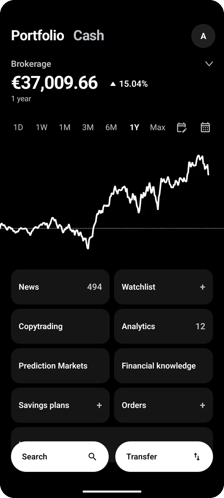
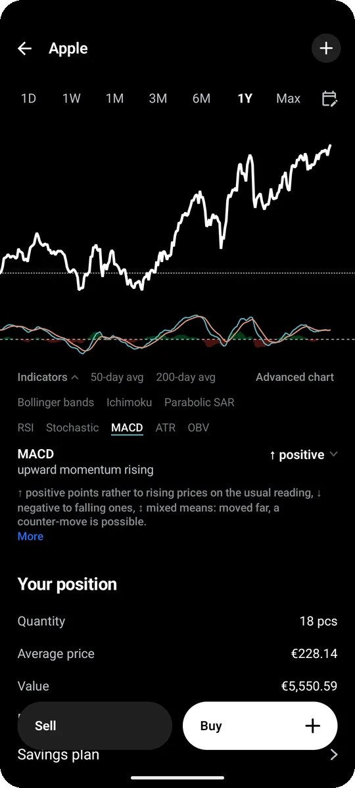
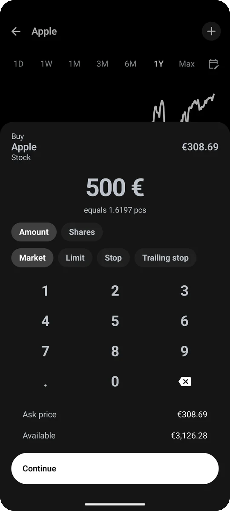
</p>

- Market, limit, stop and trailing stop orders, savings plans from weekly to quarterly, price alerts at a target price or on a daily move in percent, a note per security.
- Ten chart indicators with a plain explanation of what each one currently shows.
- Import your real transactions from a broker export to practise with your own portfolio.
- Knock-outs, factor certificates and warrants modelled by the app itself.

## See what Congress and investors trade

The official disclosures of US Representatives, senators and the President, and the quarterly holdings of 29 well-known investors. Each person has a portfolio history built from the reported trades.

<p align="center">
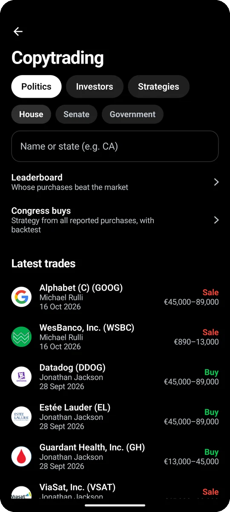
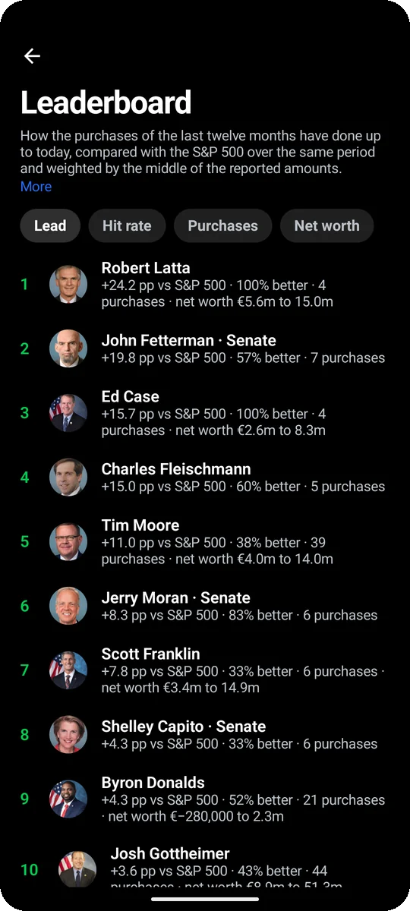
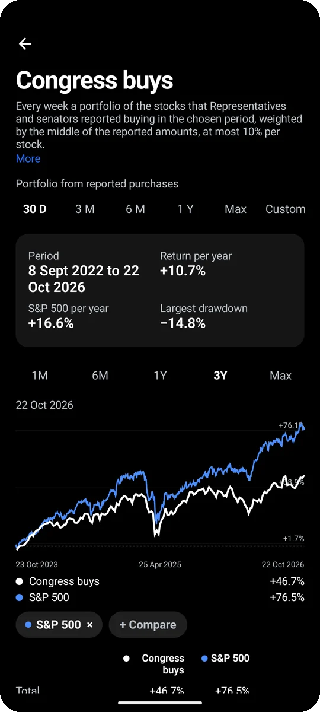
</p>

- **Leaderboard:** whose purchases of the last twelve months beat the S&P 500.
- **Congress buys:** a strategy built from all reported purchases, with a backtest from the filing date and a choice of period.
- **Insiders:** US insider purchases and sales from SEC Form 4 filings, the companies with the most buying by management and cluster buys. On the page of a stock from the US, Germany, France, the UK, the Netherlands, Sweden, Switzerland, India, Hong Kong or Australia its insider trend, weighted by each person's role, and for German stocks the major shareholders.
- Copy a person or strategy with an amount or as savings plans. A bell reports new filings.

## The politics behind a stock

Every stock page has a bull and bear case: what speaks for and against the stock, from recent headlines (lawsuits, investigations, accounting allegations, profit warnings, downgrades, record results, contracts) and key figures (analyst targets, growth, margins, debt, free cash flow, earnings surprises, valuation, cyclical industry, insider trend), each with its evidence.

On the page of every US stock: lobbying spending, the bills the company lobbied on and the members of Congress who traded the stock, federal contracts, campaign contributions, short selling and layoff notices. Stocks listed in Paris, Stockholm and London show the published short positions and how they changed over the last year. Pharma, biotech and medtech stocks show FDA approvals and recalls of the last twelve months.

<p align="center">
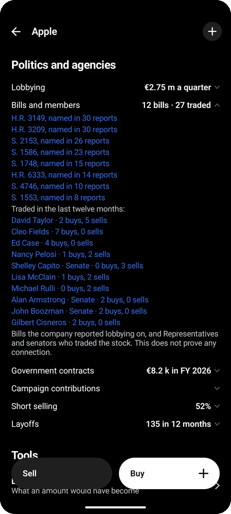
</p>

## Trends, mood and heatmap

Fear & Greed for stocks and crypto, the mood of retail investors, whether the major indices are in a bull or bear market, five early warning signs, how large speculators are positioned in futures on stocks, gold, oil, the euro, bonds and bitcoin, the most discussed stocks on Reddit and a heatmap of the 500 largest companies, your portfolio or an index.

<p align="center">
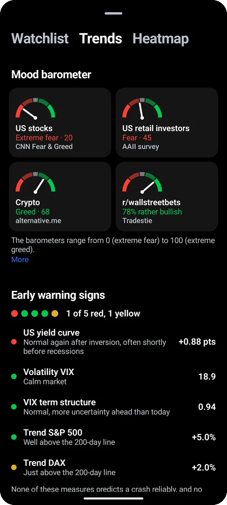
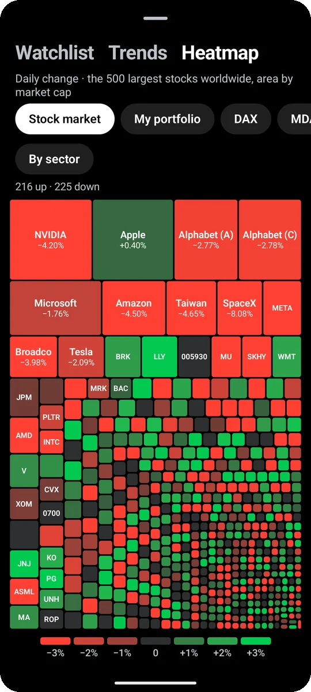
</p>

## Prediction markets

Polymarket and Kalshi with practice money. The biggest bets of the last day, week or month, sorted by topic. With your public Polymarket address the app also shows your real positions, read only.

<p align="center">
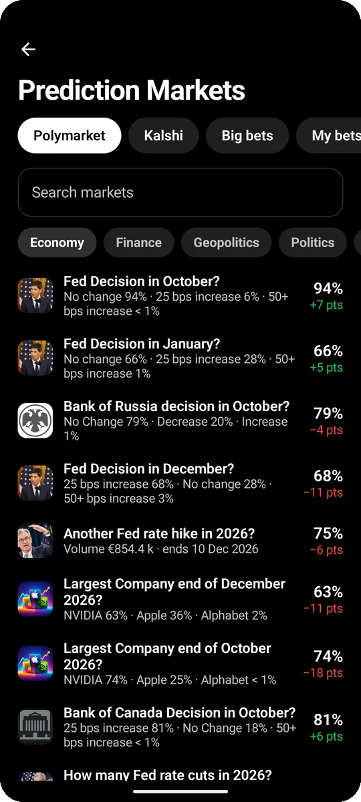
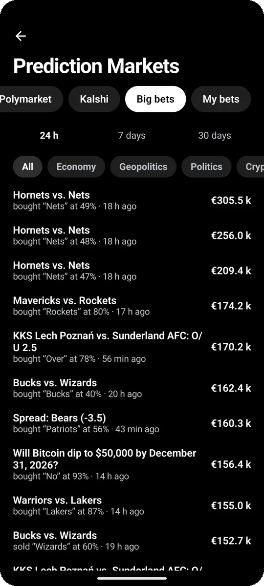
</p>

## Analyse your portfolio

Returns as in Portfolio Performance (time-weighted and IRR, capital account, months and years, drawdown and volatility), a portfolio check with traffic lights, a crash test with six crises since 2000, Monte Carlo simulations for saving and withdrawing, a dividend calendar and a portfolio finder that ranks stocks by value, momentum, growth and quality.

<p align="center">
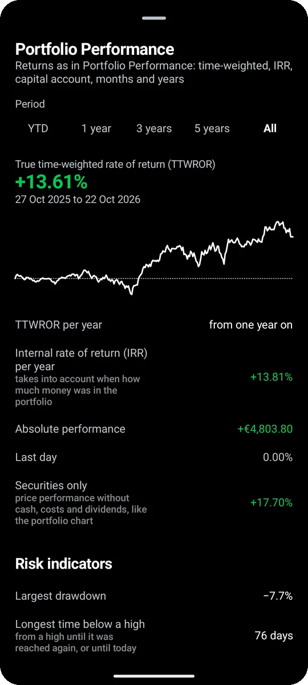
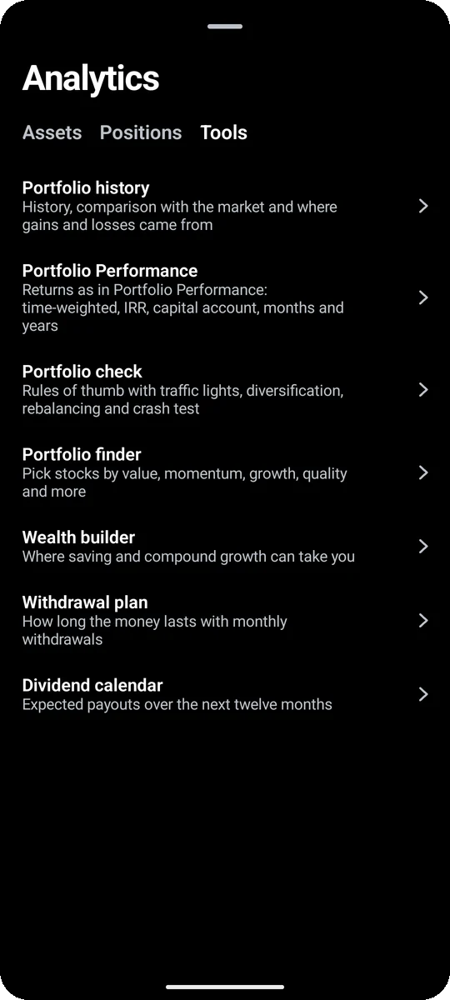
</p>

## News and learning

Headlines from financial news, central banks and authorities with the article text in the app, important news highlighted. The learning section has 20 topics with 206 lessons, charts and calculators, offline.

<p align="center">
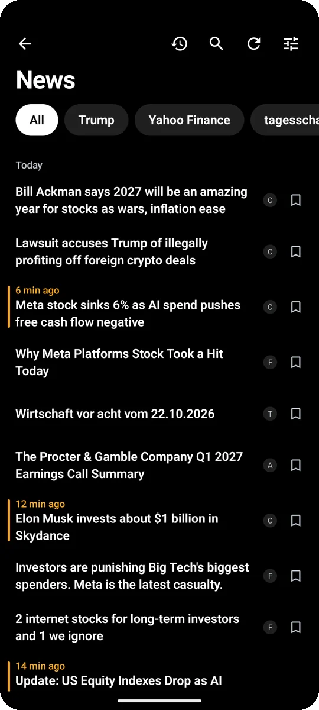
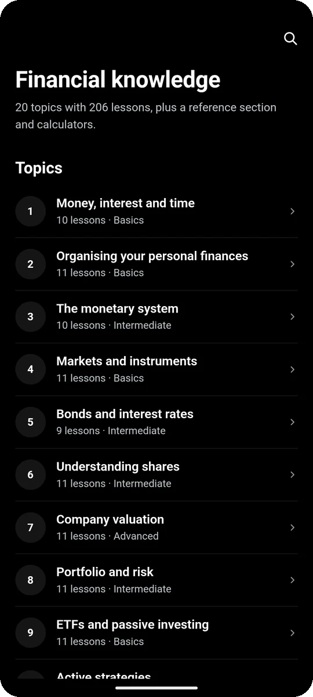
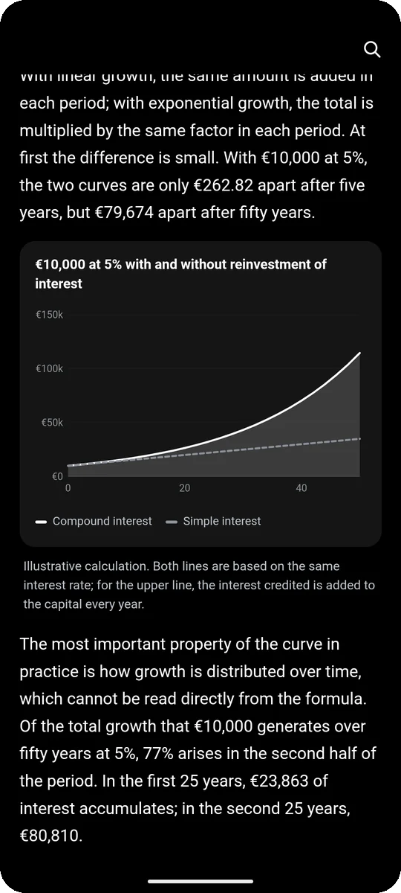
</p>

## Widgets and desktop

Nine home screen widgets on Android: portfolio (today, year to date or since purchase), watchlist or your own named lists (scrollable, sorted by daily change if you like), single stock, markets, top and flop, dividends, a fear and greed gauge, headlines about your holdings and shortcuts. Each widget has its own background (solid, translucent or none) and light or dark text, and a tap switches between amount and percent. The desktop version for Windows, macOS and Linux has the same features in a window, and a portfolio moves between phone and computer as a file.

## Features in detail

<details>
<summary><b>Portfolio and trading</b></summary>

- Stocks, ETFs, crypto and indices with prices from Yahoo Finance, watchlist, search with top movers, popular, IPOs and filter pages.
- Market, limit, stop and trailing stop orders (good for the day or 360 days) with an adjustable spread, a €1 third-party fee and the trading hours of the exchanges.
- Savings plans from weekly to quarterly, price alerts at a target price or on a daily move in percent, a note per security, dividends, monthly interest on cash (ECB deposit rate or your own), German withholding tax with exemption order and loss pots, settlements and an annual tax certificate.
- Knock-outs, factor certificates and warrants that the app models and prices itself (leverage up to 1000, factors up to 20). There are no third-party issuers and no real issuer prices.
- Import positions bought elsewhere with date, quantity and price; import or export a whole portfolio file (JSON), replacing or merging.
- Charts with crosshair, trading calendar with realised results, analytics by asset class and position, cash statistics.
- Indicators below the chart: 50- and 200-day moving averages, Bollinger bands, Ichimoku, parabolic SAR, RSI, stochastic, MACD, ATR and OBV. A tap on “Indicators” lists them, each name switches its indicator on or off, several at once; another tap hides them all. Underneath, the app reads what they currently show; a tap opens the reason and how much weight such a signal carries.
- Options analysis for US stocks from the free option chain: put/call ratio, expected move until the next expiry, max pain, implied volatility next to the stock's own, and unusual activity (large new positions with an estimate of whether they were bought or sold).
- Amounts in your chosen currency; a tap on the portfolio value, cash or a price switches to US dollars and euros, and securities with another home currency (yuan, pounds, kroner) also show that on their page. Bookings and taxes stay in euros.
- The app recognises listings of the same stock on several exchanges, fills in missing data and uses the fresher price.
</details>

<details>
<summary><b>Portfolio history</b></summary>

- In analytics under tools: the portfolio curve with ▲ at buys and ▼ at sells, from one month to the whole time, with the MSCI World and further comparison lines. Dragging across the chart shows the day's change, the holdings that drove it and the trades of that day.
- The biggest gains and drops per day, week or month with their causes, such as “From Turbo Long NVIDIA +€489, NVIDIA +€163”.
- Gain and loss by holding over the period, sold holdings included, and all buys and sells.
</details>

<details>
<summary><b>Copytrading</b></summary>

- **House:** all trades from the official STOCK Act filings; the app reads the filings itself. Scanned paper filings come with the app, already read by text recognition.
- **Senate:** trades of the last three years from the Senate eFD system as a bundled snapshot (the system does not allow requests from outside the US).
- **President:** Donald Trump's trades from his periodic reports (278-T) and his 2025 annual report (278e), matched to ticker symbols by name. Plus his Truth Social posts from the independent archive “Trump's Truth”, without signing in and without requests to Truth Social.
- **Insiders:** US insider trades from SEC Form 4 filings (officers, directors and holders of more than 10 %): open market purchases and sales of the last 18 months, sales under pre-arranged trading plans marked, the companies with the most buying and selling by management in 90 days and cluster buys. On the page of a US or German stock the insider trend of 90 days: each person counts once, weighted by role (CEO, CFO and management board ×3, other officers ×2, board members ×1.5, close associates and major holders ×1). German stocks also show the trades of their management reported to BaFin and the major shareholders (voting rights from 3 %). New US reports arrive with each version, or in the app with a contact address for the SEC under Access.
- **Investors:** the 13F holdings of 29 investors with changes from the previous quarter, among them Warren Buffett, Bill Ackman, David Tepper, Stanley Druckenmiller, Cathie Wood, Bridgewater and Howard Marks.
- **Strategies:** ten model portfolios made of ETFs, from defensive to offensive, with figures for the last ten years.
- **Portfolio history:** for each person a chart built from the reported trades with markers for buys and sales, for investors from the quarterly holdings since 2021. Daily comparison lines against MSCI World, S&P 500, Nasdaq 100, DAX, other people or your own portfolio, with return, volatility, drawdown, Sharpe, Sortino and Calmar ratios, beta, alpha and correlation.
- **Current positions** of each person and the analytics tools (portfolio check, diversification, crash test, dividends and more) applied to that portfolio.
- **Trade calendar:** next to the periods, a month calendar: days with more buys in green, with more sales in red, with the number of trades; a tap shows every trade of that day.
- **Analysis:** for each person, how bought and sold securities did after 30, 90 and 365 days, also against the S&P 500, plus size and frequency of the trades, unusual months and trades before large price moves compared with random days.
- **Derivatives:** options appear under each current position as smaller branches (shares and every option with strike and expiry, each with its share of the position); a tap opens the modelled warrant. Options with strike and expiry count in the portfolio history at their Black-Scholes value from the underlying's price; exercised options end on the day of exercise. For investors, calls and puts according to the 13F appear as branches under their stock in the holdings.
- **Notifications:** the bell on a person's page reports new filings, on Android even when the app is closed.
- **Copy** a person or strategy with an amount or as savings plans, and **who trades it** on every stock page.
- **Leaderboard:** Representatives and senators ranked by how their purchases of the last twelve months did against the S&P 500, by hit rate, number of purchases or net worth.
- **Congress buys:** a strategy rebuilt every week from all stocks that members of Congress reported buying in a chosen period (30 days to all), weighted by the reported amounts. When the same person reports a sale, their share is removed from that day on. With a backtest from the filing date against the S&P 500 and a copy function.
- **Net worth:** for Representatives a range from the latest annual financial disclosure report (assets minus liabilities).
- **Politics and agencies** on the page of every US stock: lobbying spending per quarter with issues, bills lobbied on and the members of Congress who traded the stock, federal contracts per fiscal year, campaign contributions of the company PAC, short selling (daily short volume and short interest), layoff notices under the WARN Act and, with your own key, patents granted.
</details>

<details>
<summary><b>News</b></summary>

- Headlines by provider: Yahoo Finance, tagesschau, CNBC, MarketWatch, central banks (ECB, Fed, Bank of England, SNB) and authorities (Destatis, European Commission, BEA), each with subcategories.
- Trump: his Truth Social posts as a tab of their own; posts on the economy, markets, tariffs, conflicts and wars also appear under “All”, marked with their topics.
- Letters and blogs: shareholder letters and memos (Berkshire Hathaway, Howard Marks, Markel, Fairfax, JPMorgan Chase, Amazon, GMO, Li Lu) and blogs on economics and investing.
- The app reads the article text from the page. Press releases of the European Commission come through its interface, speeches and documents of the central banks from the linked PDF, and short news is shown even with a single paragraph.
- A points system highlights important news (rate decisions, conflicts, tariffs, major economic data, strong price moves), with priority for securities in your portfolio.
- Your own RSS feeds, search, bookmarks; The Guardian, Finnhub and Alpha Vantage with your own free key.
</details>

<details>
<summary><b>Prediction markets</b></summary>

- Markets from Polymarket and Kalshi in the categories economy, finance, geopolitics, politics and trends, with search, the probabilities of all outcomes, their history and the rules.
- Bets with practice money: a share pays €1 if the outcome happens; open bets count towards the portfolio value, resolved ones are paid out. “My bets” shows profit and loss over time.
- Big bets: the largest Polymarket bets of the last 24 hours, 7 or 30 days, with topics as on Polymarket, and on each event page the largest bets on that event.
- Your real Polymarket positions under “My bets” when you enter your public address under Access. The app can only read them.
- Titles come in English only; with your own DeepL key the app translates them.
</details>

<details>
<summary><b>Tools and learning</b></summary>

- On the security page: lump sum and savings plan in hindsight, volatility and drawdowns, dividends, fair value, position size, sale with tax.
- In analytics: portfolio check with traffic lights (largest position, spread, sectors, foreign currency, leverage, crypto, order costs, reserve, savings plan, deep losses), portfolio history, comparison with the market, wealth building and withdrawal plan as Monte Carlo simulations, crash test with six crises since 2000, dividend calendar, diversification, rebalancing, analysis of sales.
- Portfolio finder: pick a market (all stocks in the catalogue, the US, Europe or one of 20 indices such as S&P 500, DAX or Nikkei 225), the number of stocks, a minimum score and the weights of value, momentum, growth, volatility (low is better), quality and dividend. The app ranks every stock per factor, shows the best ones with score, volatility and one-year return next to the index, and copies the result into the practice portfolio with equal weights.
- Learning section: 20 topics with 206 lessons, charts and calculators, offline, in German and English, checked against primary sources.
</details>

## Installation

Files are in the [latest release](../../releases/latest), older ones under [releases](../../releases).

<details>
<summary><b>Notes for Windows, Mac and Linux</b></summary>

- The desktop packages bring their own Java runtime and are not signed. Windows asks via SmartScreen on first start ("More info", then "Run anyway").
- Mac: control-click `Tryfolio.app` on first start and choose "Open"; if macOS says the app is damaged, run `xattr -dr com.apple.quarantine Tryfolio.app` in Terminal.
- Debian and Ubuntu: `sudo apt install ./tryfolio_<version>_amd64.deb`.
- Checksums are in `SHA256-windows.txt`, `SHA256-linux.txt` and `SHA256-mac.txt`.
- Desktop data: Windows `%APPDATA%\Tryfolio`, macOS `~/Library/Application Support/Tryfolio`, Linux `~/.local/share/tryfolio`. A portfolio moves between phone and computer via "Export portfolio" and "Import portfolio".
- Once a day the app asks GitHub for a new version and reports each new one once; the profile then shows a download link. It can be switched off in the profile under notifications.
</details>

<details>
<summary><b>Building</b></summary>

Requirements: JDK 17, Android SDK 35 with build tools 35.0.0. AGP 8.7.3, Kotlin 2.1.0, Gradle 8.9, Compose Multiplatform 1.7.3; minSdk 26, targetSdk 35.

```sh
./gradlew :app:testDebugUnitTest :app:lintDebug :app:assembleRelease   # Android
./gradlew :desktop:run                  # start the desktop app
./gradlew :desktop:test                 # tests and a walk through the interface without a window
./gradlew :desktop:createDistributable  # program folder with its own Java runtime
./gradlew :desktop:packageMsi           # Windows installer (downloads WiX)
./gradlew :desktop:packageDeb           # Debian package, Linux only
```

On Windows use `gradlew.bat`. `Tryfolio --selbsttest <file>` checks a finished desktop package without a window. How the app is tested is described in [docs/QA.md](docs/QA.md) (German).

| Directory | Contents |
|---|---|
| `app/src/main/java/…/ui` | Compose interface |
| `…/engine` | valuation, trading, derivatives, exchange rates, practice bets, indicators, options analysis, tools |
| `…/market` | prices, news, prediction markets, copytrading (filings, PDF reader, 13F data, derivatives, portfolio histories) |
| `…/data`, `…/i18n` | models, storage, settings, German and English |
| `app/src/main/assets` | learning section, catalogue, bundled copytrading data |
| `app/src/android/java` | Android only: activity and platform layer |
| `desktop` | Windows, macOS and Linux: window, platform layer, self-test, tests |
| `tools` | Senate filings, the President's history, paper filings of the House |
| `app/src/test` | tests for Android and desktop |
</details>

<details>
<summary><b>Limitations</b></summary>

- **Execution:** orders and savings plans run while the app is open. In the background, Android only checks for new filings and new versions.
- **Prices:** Yahoo Finance is an unofficial interface and prices may be delayed. The dollar display converts older chart values at today's rate; percentages stay the same.
- **Indicators and options:** indicators only describe past prices. The option chain is as of the last trading day with open interest from the day before; without the order book, whether a trade was bought or sold is an estimate from the last price.
- **Congress:** filings give amounts only as ranges, totals are estimates from the middle. Trades are reported up to 45 days later. Paper filings are read by text recognition; uncertain rows are left out, new paper filings come with the next version. The Senate data is a bundled snapshot.
- **President:** the periodic reports are scanned; whatever could not be read reliably is missing. Names without a reliable ticker and bonds are not in the history (the app states how many). According to his annual reports, managers run the accounts.
- **Investors:** the 13F holdings come with the app because the SEC only serves its archives to requests with contact details; the app detects new filings. 13F covers listed US securities only, no short positions, and for options only the value of the underlying without strike or expiry.
- **Portfolio histories:** for investors the holdings are only known at quarter end. For Representatives amounts are estimates, options without strike and expiry count as the underlying, option values are modelled with Black-Scholes (60-day volatility, 4 % rate, no dividends), and holdings from before the period are unknown.
- **News:** MarketWatch only lets a browser read its articles. On a computer the app downloads an embedded browser (Chromium, about 150 MB) on first use if you agree; if MarketWatch asks for a confirmation, you do it once in a window. Without a subscription MarketWatch shows only the start of an article. The Guardian is read only through its interface.
- **Prediction markets:** bets use practice money at the displayed price, without fees or market depth; the Kalshi search uses an undocumented interface.
- **Desktop:** notifications only while the app is open, the learning section opens in the browser. The Mac version is not notarised by Apple. There is no version for iPhone and iPad.
</details>

<details>
<summary><b>Data sources and use</b></summary>

Prices, company data, option chains, news and filings come from third parties at runtime and are not covered by this app's licence; the terms of each source apply. Filings come from the Clerk of the US House of Representatives, the Senate eFD system and the U.S. Office of Government Ethics. Under 5 U.S.C. § 13107 they must not be used for commercial purposes, for establishing anyone's credit rating or for soliciting money; the app is a free learning and practice program. Profile pictures: unitedstates.github.io (official portraits, public domain) and Wikimedia Commons (licence per image, shown in the app; bundled under their own licences in `app/src/main/assets/copytrading/bilder`). 13F data: SEC (EDGAR) and 13f.info, tickers from OpenFIGI. Reports of managers' transactions and major holdings of voting rights: © Bundesanstalt für Finanzdienstleistungsaufsicht / www.bafin.de. US insider transactions: SEC Form 345 data sets and EDGAR. Insider transactions: Finansinspektionen (Sweden), ©Autorité des marchés financiers – droits réservés (France, BDIF), Autoriteit Financiële Markten (Netherlands), FCA National Storage Mechanism (UK), SIX Exchange Regulation (Switzerland); for India (NSE), Hong Kong (HKEX) and Australia (ASX) the app fetches the filings of the opened stock on the device for personal use only; lists you download yourself (BSE, Consob, SEDI) can be imported and stay on the device, nothing of them is bundled. Lobby registers: EU Transparency Register, German Bundestag, HATVP (France). Short positions: Autorité des marchés financiers via data.gouv.fr (Licence Ouverte 2.0), Finansinspektionen, Financial Conduct Authority. FDA approvals and recalls: openFDA (CC0). Positioning in futures markets: U.S. Commodity Futures Trading Commission (Commitments of Traders). Truth Social via the open feed of the archive “Trump's Truth” (trumpstruth.org, Defending Democracy Together, not affiliated with Truth Social). Lobbying: LD-2 reports with the Clerk of the House (bundled, tools/washington). Federal contracts: USAspending.gov. Short selling: FINRA (Reg SHO daily short sale volume, equity short interest). Campaign contributions: FEC via api.data.gov. Layoffs: WARN Feed (github.com/APVentureEngine/warn-act-notices, CC BY 4.0, bundled) and data.texas.gov. Patents: USPTO Open Data Portal (own key). Annual reports for net worth: Clerk of the House (bundled). Prediction markets: Polymarket and Kalshi. Mood barometer: CNN Business Fear & Greed Index (unofficial interface), alternative.me Crypto Fear & Greed Index, Tradestie (mood on r/wallstreetbets), AAII Sentiment Survey. Early warning signs: US Department of the Treasury (yield curve), U.S. Bureau of Labor Statistics (unemployment rate, Sahm rule), Cboe VIX and VIX3M as well as S&P 500 and DAX via Yahoo Finance. With your own key: The Guardian (Open Platform, non-commercial), Finnhub (personal use only), Alpha Vantage, DeepL, Reddit (Data API, non-commercial; Reddit grants new access only on application). The app is not affiliated with any of these providers. The check for a new version goes to the GitHub API once a day and carries only the app's identifier.

The app is not investment advice. The portfolio is virtual. A real broker account can be connected optionally; its keys stay encrypted on the device. The app does not collect usage data; all data stays on the device.
</details>

## Licence

Free and open source software (FOSS) under the GNU General Public License, version 3 or later (GPL-3.0-or-later), see [LICENSE](LICENSE).

The bundled photos, the screenshots in `docs/bilder` and the data loaded at runtime keep their own licences and terms. Authors, licences and sources are listed in [NOTICE](NOTICE). Photos visible in the screenshots are credited there as well.

---

<a id="deutsch"></a>
<p align="center">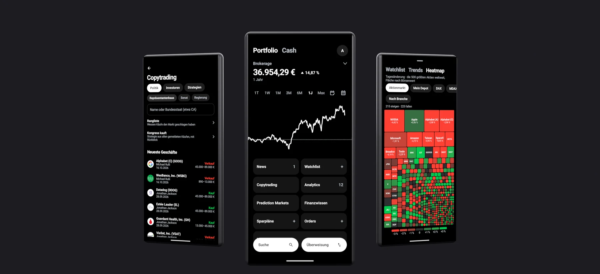</p>

<h1 align="center">Tryfolio</h1>

<p align="center"><a href="#english">English</a> · <b>Deutsch</b></p>

<p align="center">Ein Übungsdepot mit echten Kursen für Android, Windows, macOS und Linux.<br>
Mit virtuellem Geld handeln, sehen, was Abgeordnete und bekannte Investoren kaufen, und lernen, wie Geldanlage funktioniert.</p>

<p align="center"><a href="../../releases/latest"><b>Neueste Fassung herunterladen</b></a> · <a href="../../releases/latest/download/tryfolio-video-de.mp4">Video</a> · <a href="#alle-funktionen-im-detail">Alle Funktionen</a> · <a href="#installation-1">Installation</a></p>

| Gerät | Datei bei der [neuesten Fassung](../../releases/latest) |
|---|---|
| Android 8.0 oder neuer | `tryfolio-<Version>.apk` |
| Windows 10 und 11 | `Tryfolio-<Version>-windows-x64.msi` oder ohne Installation `…-windows-x64-portabel.zip` |
| Mac mit Apple-Chip | `Tryfolio-<Version>-mac-arm64.zip` |
| Debian, Ubuntu | `tryfolio_<Version>_amd64.deb` |
| andere Linux-Systeme | `tryfolio-<Version>-linux-x64.tar.gz` |

Kostenlos und quelloffen (FOSS, GPL), keine Anmeldung nötig, ohne Werbung, ohne Tracking. Alle Daten bleiben auf dem Gerät.

## Üben mit echten Kursen

Mit virtuellem Geld Aktien, ETFs und Krypto zu Live-Kursen von Yahoo Finance kaufen. Orders, Sparpläne, Dividenden, Zinsen und Abgeltungsteuer funktionieren wie bei einem echten Depot, Fehler kosten also nichts.

<p align="center">
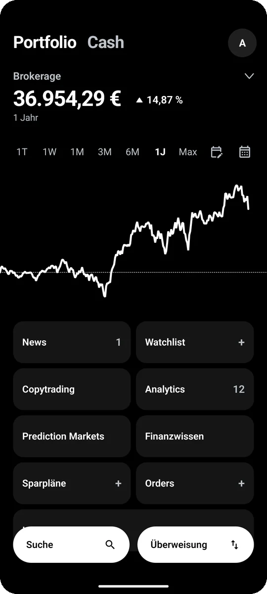
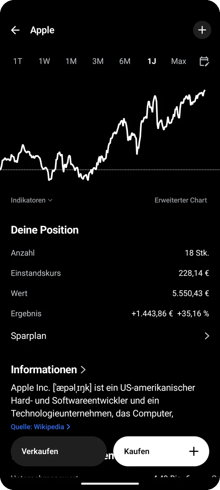
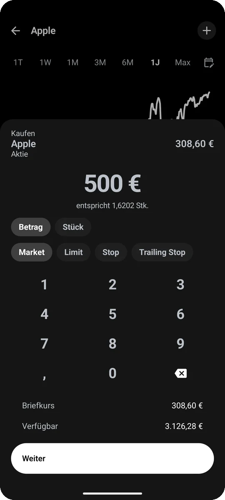
</p>

- Market-, Limit-, Stop- und Trailing-Stop-Orders, Sparpläne von wöchentlich bis vierteljährlich, Preisalarme auf eine Kursmarke oder auf die Tagesbewegung in Prozent, eine Notiz je Wertpapier.
- Zehn Indikatoren im Chart, jeweils mit einer verständlichen Erklärung, was sie gerade zeigen.
- Echte Buchungen aus dem Export eines Brokers einlesen und mit dem eigenen Depot üben.
- Knock-outs, Faktorzertifikate und Optionsscheine, die die App selbst nachbildet.

## Sehen, was Kongress und Investoren handeln

Die amtlichen Meldungen von Abgeordneten, Senatoren und dem Präsidenten der USA und die Quartalsbestände von 29 bekannten Investoren. Für jede Person gibt es einen Portfolioverlauf aus den gemeldeten Geschäften.

<p align="center">
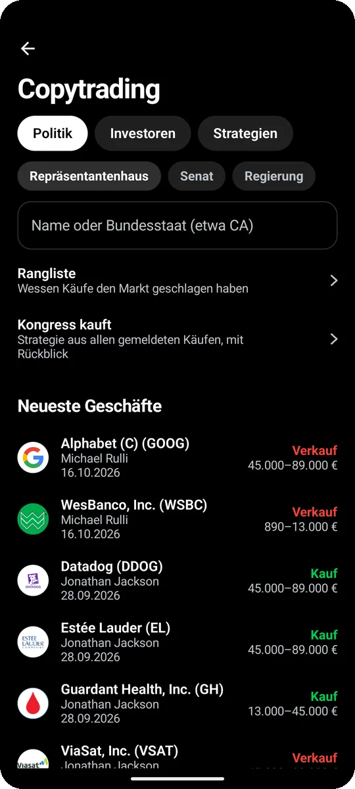
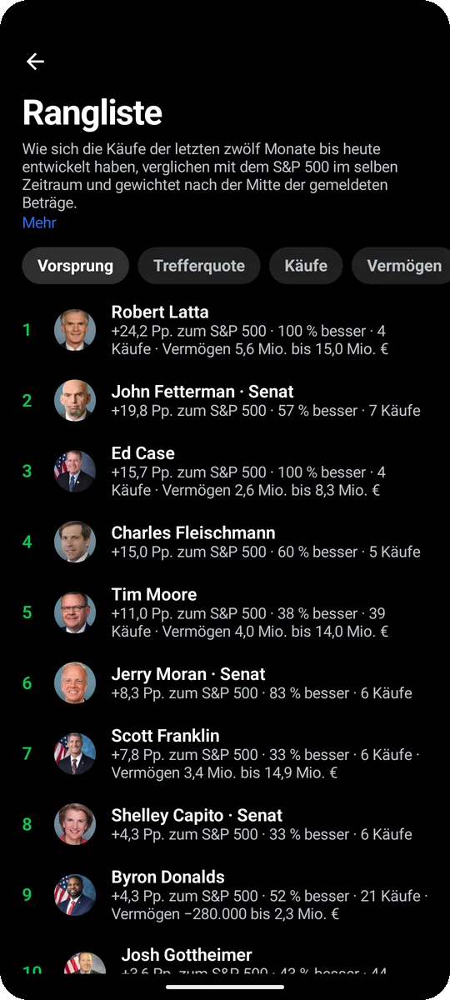
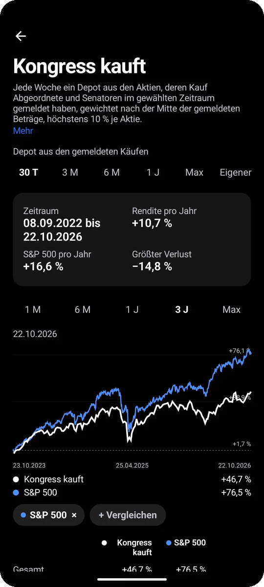
</p>

- **Rangliste:** wessen Käufe der letzten zwölf Monate den S&P 500 geschlagen haben.
- **Kongress kauft:** eine Strategie aus allen gemeldeten Käufen, mit Rückblick ab dem Tag der Meldung und wählbarem Zeitraum.
- **Insider:** Käufe und Verkäufe von US-Insidern aus den Form-4-Meldungen der SEC, die Firmen mit den meisten Käufen der Führung und Cluster-Käufe. Auf der Seite einer Aktie aus den USA, Deutschland, Frankreich, Großbritannien, den Niederlanden, Schweden, der Schweiz, Indien, Hongkong oder Australien der Insider-Trend, gewichtet nach der Rolle jeder Person, bei deutschen Aktien dazu die Großaktionäre.
- Eine Person oder Strategie mit einem Betrag oder als Sparpläne nachbilden. Eine Glocke meldet neue Meldungen.

## Politik hinter einer Aktie

Jede Aktienseite hat einen Bull- und Bear-Case: was für und was gegen die Aktie spricht, aus aktuellen Schlagzeilen (Klagen, Ermittlungen, Bilanzvorwürfe, Gewinnwarnungen, Herabstufungen, Rekordzahlen, Aufträge) und Kennzahlen (Kursziele, Wachstum, Margen, Schulden, freier Cashflow, Ergebnisüberraschungen, Bewertung, zyklische Branche, Insider-Trend), jeweils mit Beleg.

Auf der Seite jeder US-Aktie: Lobbyausgaben, die Gesetze, zu denen die Firma Lobbyarbeit gemeldet hat, und die Abgeordneten, die die Aktie gehandelt haben, Regierungsaufträge, Wahlkampfspenden, Leerverkäufe und Entlassungsmeldungen. Bei in Paris, Stockholm und London gelisteten Aktien die veröffentlichten Leerverkaufspositionen und ihr Verlauf im letzten Jahr. Bei Pharma-, Biotech- und Medizintechnik-Aktien die Zulassungen und Rückrufe der FDA aus zwölf Monaten.

## Trends, Stimmung und Heatmap

Fear & Greed für Aktien und Krypto, die Stimmung von Privatanlegern, ob die großen Indizes im Bullen- oder Bärenmarkt sind, fünf Frühwarnzeichen, die Positionierung großer Spekulanten an den Terminmärkten für Aktien, Gold, Öl, Euro, Anleihen und Bitcoin, die meistbesprochenen Aktien auf Reddit und eine Heatmap der 500 größten Unternehmen, des eigenen Depots oder eines Index.

<p align="center">
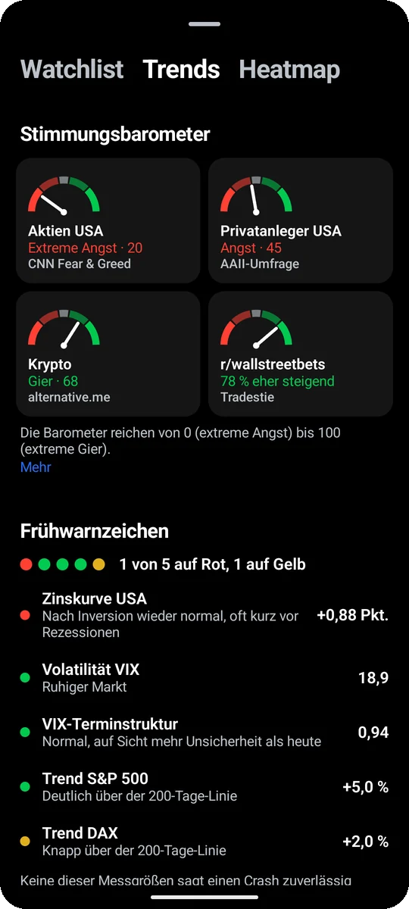
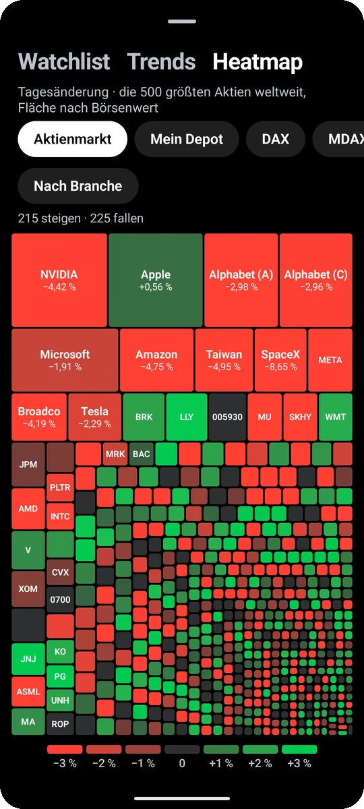
</p>

## Prediction Markets

Polymarket und Kalshi mit Übungsgeld. Die größten Wetten des letzten Tages, der letzten Woche oder des letzten Monats, nach Themen sortiert. Mit der öffentlichen Polymarket-Adresse zeigt die App auch die eigenen echten Positionen, nur zum Lesen.

<p align="center">
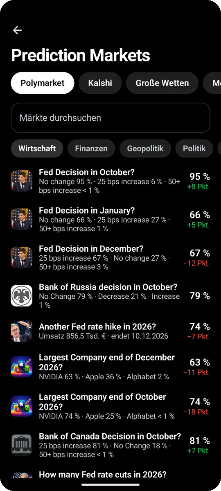
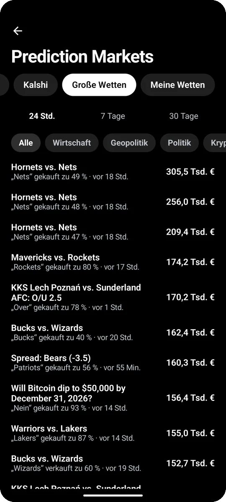
</p>

## Das Depot auswerten

Rendite wie in Portfolio Performance (zeitgewichtet und interner Zinsfuß, Kapitalbilanz, Monate und Jahre, Rückgang und Schwankung), ein Depot-Check mit Ampel, ein Crash-Test mit sechs Krisen seit 2000, Monte-Carlo-Simulationen für Sparen und Entnehmen, ein Dividendenkalender und ein Depotfinder, der Aktien nach Value, Momentum, Wachstum und Qualität ordnet.

<p align="center">
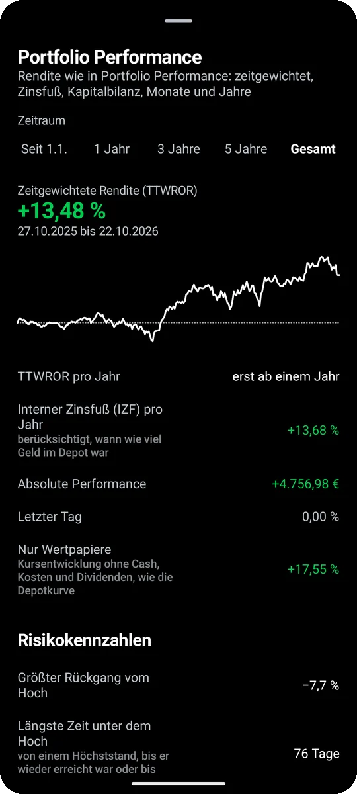
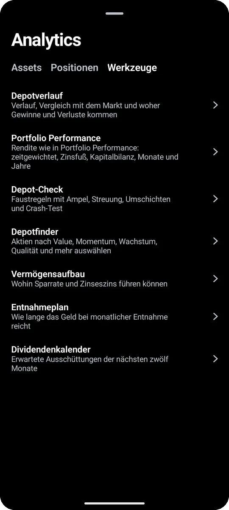
</p>

## Nachrichten und Lernen

Schlagzeilen aus Finanznachrichten, von Notenbanken und Behörden mit dem Artikeltext in der App, wichtige Meldungen hervorgehoben. Das Finanzwissen hat 20 Themen mit 206 Lektionen, Diagrammen und Rechnern, ohne Internet.

<p align="center">
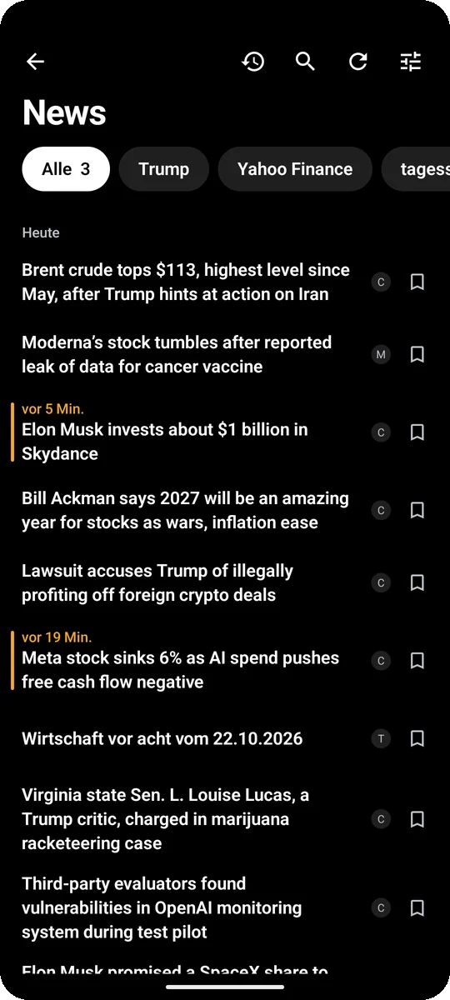
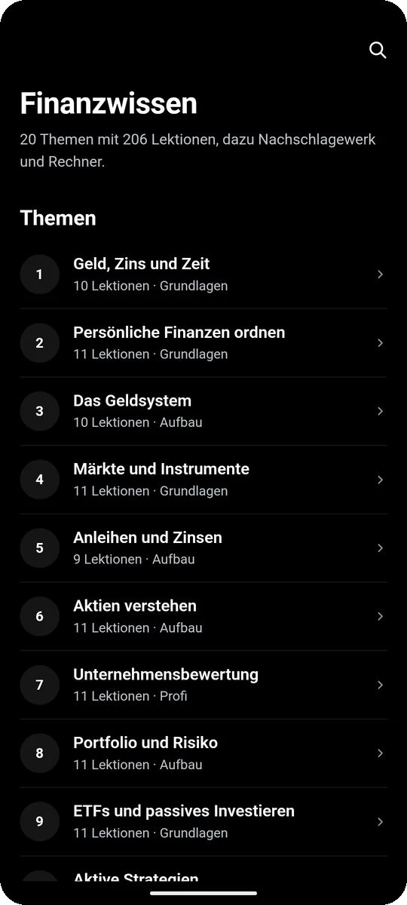
</p>

## Widgets und Desktop

Neun Widgets für den Startbildschirm unter Android: Depot (heute, seit Jahresbeginn oder seit Kauf), Werte oder eigene Listen mit Namen (rollbar, auf Wunsch nach Tagesänderung geordnet), Einzelwert, Märkte, Top & Flop, Dividenden, ein Angst-und-Gier-Tacho, Schlagzeilen zu den eigenen Positionen und Schnellzugriff. Jedes Widget hat einen eigenen Grund (deckend, durchscheinend oder ohne) und helle oder dunkle Schrift, ein Tipp schaltet zwischen Betrag und Prozent um. Die Desktop-Fassung für Windows, macOS und Linux hat dieselben Funktionen im Fenster, ein Depot wechselt als Datei zwischen Telefon und Rechner.

## Alle Funktionen im Detail

<details>
<summary><b>Depot und Handel</b></summary>

- Aktien, ETFs, Krypto und Indizes mit Kursen von Yahoo Finance, Watchlist, Suche mit Top Movers, Beliebt, IPOs und Filterseiten.
- Market-, Limit-, Stop- und Trailing-Stop-Orders (tagesgültig oder 360 Tage) mit einstellbarem Spread, 1 € Fremdkostenpauschale und den Handelszeiten der Börsen.
- Sparpläne von wöchentlich bis vierteljährlich, Preisalarme auf eine Kursmarke oder die Tagesbewegung in Prozent, eine Notiz je Wertpapier, Dividenden, monatliche Zinsen auf das Guthaben (EZB-Einlagesatz oder eigener Satz), Abgeltungsteuer mit Freistellungsauftrag und Verlusttöpfen, Abrechnungen und Jahressteuerbescheinigung.
- Knock-outs, Faktorzertifikate und Optionsscheine, die die App selbst modelliert und berechnet (Hebel bis 1000, Faktoren bis 20). Es gibt keine fremden Emittenten und keine echten Emittentenkurse.
- Positionen übernehmen: ein anderswo gekauftes Wertpapier mit Kaufdatum, Stückzahl und Kaufkurs ins Depot holen. Unter „Importieren“ lässt sich eine ganze Portfolio-Datei (JSON) einlesen, anstelle des Depots oder mit ihm zusammengeführt, und das Depot als Datei sichern.
- Charts mit Fadenkreuz, Handelskalender mit realisierten Ergebnissen, Analytics nach Anlageklassen und Positionen, Cash-Statistik.
- Indikatoren unter dem Chart: gleitende Durchschnitte über 50 und 200 Tage, Bollinger-Bänder, Ichimoku, Parabolic SAR, RSI, Stochastik, MACD, ATR und OBV. Ein Tipp auf „Indikatoren“ zeigt ihre Namen, jeder Name schaltet seinen Indikator ein oder aus, auch mehrere zugleich; ein weiterer Tipp blendet alles aus. Darunter liest die App, was sie gerade anzeigen; ein Tipp öffnet den Grund und wie viel ein solches Signal aussagt.
- Optionen bei US-Aktien aus der frei abrufbaren Optionskette: Put/Call-Verhältnis, erwartete Bewegung bis zum nächsten Verfall, Max Pain, implizite Volatilität neben der Schwankung der Aktie und auffällige Umsätze (große neue Positionen mit einer Schätzung, ob gekauft oder verkauft wurde).
- Anzeige in der gewählten Währung, per Tipp auf Depotwert, Guthaben oder Kurs weiter in US-Dollar und Euro; Werte mit anderer Heimatwährung (Yuan, Pfund, Kronen) zeigen auf ihrer Seite auch diese. Buchungen und Steuern bleiben in Euro.
- Die App erkennt Notierungen derselben Aktie an mehreren Börsenplätzen, übernimmt fehlende Angaben und nimmt den frischeren Kurs.
</details>

<details>
<summary><b>Depotverlauf</b></summary>

- Unter Analytics bei den Werkzeugen: die Kurve des Depots mit ▲ an den Käufen und ▼ an den Verkäufen, von einem Monat bis zur ganzen Zeit, mit dem MSCI World und weiteren Vergleichslinien. Beim Ziehen über den Graphen erscheinen die Veränderung des Tages, die Werte, die sie getragen haben, und die Geschäfte dieses Tages.
- Die größten Anstiege und Rückgänge je Tag, Woche oder Monat mit ihren Ursachen, etwa „Durch Turbo Long NVIDIA +489 €, NVIDIA +163 €“.
- Gewinn und Verlust je Wert im Zeitraum, auch für verkaufte Werte, und alle Käufe und Verkäufe.
</details>

<details>
<summary><b>Copytrading</b></summary>

- **Repräsentantenhaus:** alle Geschäfte aus den amtlichen Meldungen nach dem STOCK Act; die App liest die Meldungen selbst. Eingescannte Papiermeldungen bringt die App ausgelesen mit.
- **Senat:** die Geschäfte der letzten drei Jahre aus dem Senate-eFD-System als mitgelieferter Stand (das System lässt Abrufe von außerhalb der USA nicht zu).
- **Präsident:** die Geschäfte von Donald Trump aus seinen Einzelmeldungen (278-T) und seiner Jahresmeldung 2025 (278e), über die Namen den Börsenkürzeln zugeordnet. Dazu seine Beiträge auf Truth Social aus dem unabhängigen Archiv „Trump's Truth“, ohne Anmeldung und ohne Abruf bei Truth Social.
- **Insider:** Geschäfte von US-Insidern aus den Form-4-Meldungen der SEC (Officers, Directors und Aktionäre über 10 %): Käufe und Verkäufe an der Börse der letzten 18 Monate, Verkäufe aus festen Verkaufsplänen gekennzeichnet, die Firmen mit den meisten Käufen und Verkäufen der Führung in 90 Tagen und Cluster-Käufe. Auf der Seite einer US- oder deutschen Aktie der Insider-Trend über 90 Tage: Jede Person zählt einmal, gewichtet nach ihrer Rolle (Vorstand und Spitze ×3, weitere Führungskräfte ×2, Aufsichtsrat ×1,5, Nahestehende und Großaktionäre ×1). Deutsche Aktien zeigen dazu die Geschäfte ihrer Führung aus den Meldungen an die BaFin und die Großaktionäre (Stimmrechte ab 3 %). Neue US-Meldungen kommen mit jeder Fassung oder in der App mit einer Kontaktadresse für die SEC unter Zugänge.
- **Investoren:** die 13F-Bestände von 29 Investoren mit Veränderung zum Vorquartal, darunter Warren Buffett, Bill Ackman, David Tepper, Stanley Druckenmiller, Cathie Wood, Bridgewater und Howard Marks.
- **Strategien:** zehn Musterportfolios aus ETFs, von defensiv bis offensiv, mit Kennzahlen der letzten zehn Jahre.
- **Portfolioverlauf:** je Person ein Graph aus den gemeldeten Geschäften mit Marken für Käufe und Verkäufe, bei Investoren aus den Quartalsbeständen seit 2021. Vergleichslinien mit Tageswerten gegen MSCI World, S&P 500, Nasdaq 100, DAX, andere Personen oder das eigene Depot, mit Rendite, Schwankung, Rückgang, Sharpe-, Sortino- und Calmar-Quote, Beta, Alpha und Korrelation.
- **Aktuelle Positionen** jeder Person und die Werkzeuge aus Analytics (Depot-Check, Streuung, Crash-Test, Dividenden und mehr) für dieses Depot.
- **Kalender der Geschäfte:** neben den Zeiträumen ein Monatskalender: Tage mit mehr Käufen grün, mit mehr Verkäufen rot, darin die Zahl der Geschäfte; ein Tipp zeigt jedes Geschäft des Tages.
- **Auswertung:** je Person, wie sich gekaufte und verkaufte Werte nach 30, 90 und 365 Tagen entwickelt haben, auch gegen den S&P 500, dazu Größe und Häufigkeit der Geschäfte, auffällige Monate und Geschäfte vor großen Kursbewegungen im Vergleich zu zufälligen Tagen.
- **Derivate:** Optionen stehen unter jeder aktuellen Position als kleinere Unterzweige (Aktien und jede Option mit Basispreis und Verfall, je mit Anteil an der Position); ein Tipp öffnet den nachgebildeten Optionsschein. Optionen mit Basispreis und Verfall gehen mit ihrem Wert nach Black-Scholes aus dem Kurs des Basiswerts in den Portfolioverlauf ein; ausgeübte Optionen enden am Tag der Ausübung. Bei Investoren stehen Calls und Puts laut 13F als Unterzweige unter ihrer Aktie in den Beständen.
- **Mitteilungen:** Die Glocke auf der Seite einer Person meldet neue Meldungen, auf Android auch bei geschlossener App.
- **Nachbilden** einer Person oder Strategie mit einem Betrag oder als Sparpläne, und **Wer handelt den Wert** auf jeder Aktienseite.
- **Rangliste:** Abgeordnete und Senatoren danach, wie sich ihre Käufe der letzten zwölf Monate gegen den S&P 500 entwickelt haben, nach Trefferquote, Zahl der Käufe oder Vermögen.
- **Kongress kauft:** eine Strategie, jede Woche neu aus allen Aktien, deren Kauf Abgeordnete und Senatoren in einem wählbaren Zeitraum gemeldet haben (30 Tage bis alles), gewichtet nach den gemeldeten Beträgen. Meldet dieselbe Person einen Verkauf, fällt ihr Anteil ab diesem Tag weg. Mit Rückblick ab dem Tag der Meldung gegen den S&P 500 und zum Nachbilden.
- **Vermögen:** bei Abgeordneten eine Spanne aus der neuesten Jahresmeldung (Vermögenswerte abzüglich Verbindlichkeiten).
- **Politik und Behörden** auf der Seite jeder US-Aktie: Lobbyausgaben je Quartal mit Themen, Gesetze, zu denen die Firma Lobbyarbeit gemeldet hat, und die Abgeordneten, die die Aktie gehandelt haben, Regierungsaufträge je Fiskaljahr, Wahlkampfspenden des Firmen-PACs, Leerverkäufe (täglich leer verkaufter Umsatz und offene Leerverkäufe), Entlassungsmeldungen nach dem WARN Act und mit eigenem Schlüssel erteilte Patente.
</details>

<details>
<summary><b>News</b></summary>

- Schlagzeilen nach Anbietern: Yahoo Finance, tagesschau, CNBC, MarketWatch, Notenbanken (EZB, Fed, Bank of England, SNB) und Behörden (Destatis, EU-Kommission, BEA), jeweils mit Unterkategorien.
- Trump: seine Beiträge auf Truth Social als eigener Reiter; Beiträge zu Wirtschaft, Märkten, Zöllen, Konflikten und Kriegen stehen auch unter „Alle“, mit ihren Themen markiert.
- Briefe und Blogs: Aktionärsbriefe und Memos (Berkshire Hathaway, Howard Marks, Markel, Fairfax, JPMorgan Chase, Amazon, GMO, Li Lu) und Blogs zu Wirtschaft und Geldanlage.
- Den Artikeltext liest die App aus der Seite. Pressemitteilungen der EU-Kommission kommen über deren Schnittstelle, Reden und Unterlagen der Notenbanken aus dem verlinkten PDF, kurze Meldungen auch dann, wenn sie nur einen Absatz haben.
- Wichtige Meldungen markiert eine Bewertung nach Punkten (Zinsentscheide, Konflikte, Zölle, große Konjunkturdaten, kräftige Kursbewegungen), Werte aus dem eigenen Depot haben Vorrang.
- Mitteilungen zu neuen Schlagzeilen, unter „Quellen und Mitteilungen“ einstellbar: nur die markierten wichtigen (Vorgabe), alle oder keine. Bei geöffneter App alle fünf Minuten, auf Android auch bei geschlossener App etwa alle 30 Minuten.
- Eigene RSS-Feeds, Suche, Merkliste; The Guardian, Finnhub und Alpha Vantage mit eigenem kostenlosem Schlüssel.
</details>

<details>
<summary><b>Prediction Markets</b></summary>

- Märkte von Polymarket und Kalshi in den Kategorien Wirtschaft, Finanzen, Geopolitik, Politik und Trends, mit Suche, den Wahrscheinlichkeiten aller Ausgänge, ihrem Verlauf und den Regeln.
- Wetten mit dem Übungsguthaben: Ein Anteil zahlt bei Eintreten 1 €; offene Wetten zählen zum Depotwert, entschiedene zahlt die App aus. „Meine Wetten“ zeigt Gewinn und Verlust im Verlauf.
- Große Wetten: die größten Wetten bei Polymarket in 24 Stunden, 7 oder 30 Tagen, mit Themen wie bei Polymarket, und auf der Seite eines Ereignisses die größten Wetten darauf.
- Die eigenen echten Positionen bei Polymarket unter „Meine Wetten“, wenn unter Zugänge die öffentliche Adresse eingetragen ist. Die App kann sie nur lesen.
- Titel kommen nur auf Englisch; mit einem eigenen DeepL-Schlüssel übersetzt die App sie.
</details>

<details>
<summary><b>Werkzeuge und Lernen</b></summary>

- Auf der Wertpapierseite: Einmalanlage und Sparplan im Rückblick, Schwankung und Rückgänge, Dividenden, fairer Wert, Positionsgröße, Verkauf mit Steuer.
- In Analytics: Depot-Check mit Ampel (größte Position, Streuung, Branchen, Fremdwährung, Hebel, Krypto, Orderkosten, Reserve, Sparplan, tiefe Verluste), Depotverlauf, Vergleich mit dem Markt, Vermögensaufbau und Entnahmeplan als Monte-Carlo-Simulation, Crash-Test mit sechs Krisen seit 2000, Dividendenkalender, Streuung, Umschichten, Auswertung der Verkäufe.
- Depotfinder: Markt (alle Aktien des Katalogs, USA, Europa oder einer von 20 Indizes wie S&P 500, DAX oder Nikkei 225), Zahl der Aktien, Mindestscore und die Gewichte von Value, Momentum, Wachstum, Schwankung (gering ist besser), Qualität und Dividende wählen. Die App ordnet jede Aktie je Faktor ein, zeigt die besten mit Score, Schwankung und Jahresrendite neben dem Index und bildet das Ergebnis mit gleichen Gewichten im Übungsdepot nach.
- Finanzwissen: 20 Themen mit 206 Lektionen, Diagrammen und Rechnern, ohne Internet, auf Deutsch und Englisch, an Primärquellen geprüft. Steht die App auf den USA, zeigt es Lektionen zu Steuern, Altersvorsorge, Immobilien, Krediten und Konten in einer Fassung für die USA; jede sagt das oben und zeigt auf Wunsch die deutsche Fassung.
</details>

## Installation

Die Dateien liegen bei der [neuesten Fassung](../../releases/latest), ältere bei den [Releases](../../releases).

<details>
<summary><b>Hinweise zu Windows, Mac und Linux</b></summary>

- Die Desktop-Pakete bringen ihre eigene Java-Laufzeit mit und sind nicht signiert. Windows fragt beim ersten Start über SmartScreen nach („Weitere Informationen“, dann „Trotzdem ausführen“).
- Mac: beim ersten Start mit gedrückter ctrl-Taste auf `Tryfolio.app` klicken und „Öffnen“ wählen; meldet macOS, die App sei beschädigt, hilft im Terminal `xattr -dr com.apple.quarantine Tryfolio.app`.
- Debian und Ubuntu: `sudo apt install ./tryfolio_<Version>_amd64.deb`.
- Prüfsummen stehen in `SHA256-windows.txt`, `SHA256-linux.txt` und `SHA256-mac.txt`.
- Daten der Desktop-Fassung: Windows `%APPDATA%\Tryfolio`, macOS `~/Library/Application Support/Tryfolio`, Linux `~/.local/share/tryfolio`. Ein Depot wechselt zwischen Telefon und Rechner über „Portfolio exportieren“ und „Portfolio importieren“.
- Einmal am Tag fragt die App bei GitHub nach einer neuen Fassung und meldet jede neue einmal; im Profil steht dann ein Link zum Herunterladen. Abschalten lässt sich das im Profil unter Mitteilungen.
</details>

<details>
<summary><b>Selbst bauen</b></summary>

Voraussetzungen: JDK 17, Android SDK 35 mit Build Tools 35.0.0. AGP 8.7.3, Kotlin 2.1.0, Gradle 8.9, Compose Multiplatform 1.7.3; minSdk 26, targetSdk 35.

```sh
./gradlew :app:testDebugUnitTest :app:lintDebug :app:assembleRelease   # Android
./gradlew :desktop:run                  # Desktop starten
./gradlew :desktop:test                 # Tests und Rundgang durch die Oberfläche ohne Fenster
./gradlew :desktop:createDistributable  # Programmordner mit eigener Java-Laufzeit
./gradlew :desktop:packageMsi           # Windows-Installer (lädt dazu WiX)
./gradlew :desktop:packageDeb           # Debian-Paket, nur unter Linux
```

Unter Windows `gradlew.bat` verwenden. `Tryfolio --selbsttest <Datei>` prüft ein fertiges Desktop-Paket ohne Fenster, auch die deutschen Monatsnamen und Zahlen. Wie geprüft wird, steht in [docs/QA.md](docs/QA.md).

| Verzeichnis | Inhalt |
|---|---|
| `app/src/main/java/…/ui` | Compose-Oberfläche |
| `…/engine` | Bewertung, Handel, Derivate, Wechselkurse, Übungswetten, Indikatoren, Optionsanalyse, Werkzeuge |
| `…/market` | Kurse, Nachrichten, Prediction Markets, Copytrading (Meldungen, PDF-Leser, 13F-Daten, Derivate, Portfolioverläufe) |
| `…/data`, `…/i18n` | Modelle, Speicherung, Einstellungen, Deutsch und Englisch |
| `app/src/main/assets` | Finanzwissen, Katalog, mitgelieferte Copytrading-Daten |
| `app/src/android/java` | nur Android: Aktivität und Plattformschicht |
| `desktop` | Windows, macOS und Linux: Fenster, Plattformschicht, Selbsttest, Tests |
| `tools` | Senatsmeldungen, Verlauf des Präsidenten, Papiermeldungen des Repräsentantenhauses |
| `app/src/test` | Tests für Android und Desktop |
</details>

<details>
<summary><b>Grenzen</b></summary>

- **Ausführung:** Orders und Sparpläne laufen, solange die App geöffnet ist. Im Hintergrund prüft Android nur auf neue Meldungen und neue Fassungen.
- **Kurse:** Yahoo Finance ist eine inoffizielle Schnittstelle, Kurse können verzögert sein. Die Dollaranzeige rechnet ältere Chartwerte mit dem heutigen Kurs um; die Prozentangaben bleiben gleich.
- **Indikatoren und Optionen:** Indikatoren beschreiben nur vergangene Kurse. Die Optionskette hat den Stand des letzten Handelstags, offene Kontrakte den vom Vortag; ohne Orderbuch ist die Seite eines Umsatzes nur aus dem letzten Kurs geschätzt.
- **Kongress:** Beträge stehen nur als Spanne in den Meldungen, Summen sind Schätzungen aus der Mitte. Gemeldet wird bis zu 45 Tage nach dem Geschäft. Papiermeldungen sind per Texterkennung ausgelesen; unsichere Zeilen fehlen, neue Papiermeldungen kommen mit der nächsten Fassung. Die Senatsdaten sind ein mitgelieferter Stand.
- **Präsident:** Die Einzelmeldungen sind eingescannt; was die Texterkennung nicht sicher lesen konnte, fehlt. Namen ohne sicheres Kürzel und Anleihen fehlen im Verlauf (die App nennt ihre Zahl). Laut seinen Jahresberichten führen Verwalter die Konten.
- **Investoren:** Die 13F-Bestände kommen mit der App, weil die SEC ihre Archive nur bei Abrufen mit Kontaktangaben herausgibt; neue Meldungen erkennt die App. 13F zeigt nur börsennotierte US-Werte, keine Leerverkäufe, und bei Optionen nur den Gegenwert der Basiswerte ohne Basispreis und Verfall.
- **Portfolioverläufe:** Bei Investoren ist der Bestand nur zum Quartalsende bekannt. Bei Abgeordneten sind Beträge geschätzt, Optionen ohne Basispreis und Verfall zählen als Basiswert, Optionswerte sind nach Black-Scholes modelliert (60 Tage Schwankung, 4 % Zins, ohne Dividenden), Bestände von vor dem Zeitraum sind unbekannt.
- **News:** MarketWatch lässt seine Artikel nur von einem Browser lesen. Am Rechner lädt die App dafür beim ersten Mal auf Wunsch einen eingebetteten Browser (Chromium, etwa 150 MB); verlangt MarketWatch eine Bestätigung, erledigt man sie einmal im Fenster. Ohne Abo zeigt MarketWatch nur den Anfang eines Artikels. Den Guardian liest die App nur über seine Schnittstelle.
- **Prediction Markets:** Gewettet wird nur mit Übungsgeld zum angezeigten Kurs, ohne Gebühren und Markttiefe; die Suche bei Kalshi nutzt eine nicht dokumentierte Schnittstelle.
- **Desktop:** Mitteilungen erscheinen nur bei geöffneter App, Finanzwissen öffnet im Browser. Die Mac-Fassung ist nicht von Apple beglaubigt. Für iPhone und iPad gibt es keine Fassung.
</details>

<details>
<summary><b>Datenquellen und Nutzung</b></summary>

Kurse, Firmendaten, Optionsketten, Nachrichten und Meldungen kommen zur Laufzeit von Drittanbietern und fallen nicht unter die Lizenz dieser App; es gelten die Bedingungen der jeweiligen Quelle. Eigengeschäfte von Führungskräften und Stimmrechtsanteile: © Bundesanstalt für Finanzdienstleistungsaufsicht / www.bafin.de. US-Insidergeschäfte: Form-345-Datensätze und EDGAR der SEC. Insidergeschäfte: Finansinspektionen (Schweden), ©Autorité des marchés financiers – droits réservés (Frankreich, BDIF), Autoriteit Financiële Markten (Niederlande), FCA National Storage Mechanism (Großbritannien), SIX Exchange Regulation (Schweiz); für Indien (NSE), Hongkong (HKEX) und Australien (ASX) holt die App die Meldungen der geöffneten Aktie auf dem Gerät nur für den eigenen Gebrauch; selbst heruntergeladene Listen (BSE, Consob, SEDI) lassen sich importieren und bleiben auf dem Gerät, davon liegt nichts im Programm. Lobbyregister: EU-Transparenzregister, Deutscher Bundestag, HATVP (Frankreich). Leerverkaufspositionen: Autorité des marchés financiers über data.gouv.fr (Licence Ouverte 2.0), Finansinspektionen, Financial Conduct Authority. Zulassungen und Rückrufe: openFDA der U.S. Food and Drug Administration (CC0). Positionierung an den Terminmärkten: U.S. Commodity Futures Trading Commission (Commitments of Traders). Die Meldungen der Abgeordneten stammen vom Clerk des US-Repräsentantenhauses, die des Senats aus dem Senate-eFD-System, die des Präsidenten und des Vizepräsidenten vom U.S. Office of Government Ethics. Nach 5 U.S.C. § 13107 dürfen sie nicht für kommerzielle Zwecke, zur Feststellung der Kreditwürdigkeit oder zum Einwerben von Geld verwendet werden; die App ist ein kostenloses Lern- und Übungsprogramm. Profilbilder der Kongressmitglieder kommen von unitedstates.github.io (amtliche Porträts, gemeinfrei), die der Investoren und der Regierung aus Wikimedia Commons (Lizenz je Bild, in der App genannt; unter eigener Lizenz in `app/src/main/assets/copytrading/bilder`). 13F-Daten: SEC (EDGAR) und 13f.info, Kürzel von OpenFIGI. Truth Social über den offenen Feed des Archivs „Trump's Truth“ (trumpstruth.org, Defending Democracy Together, nicht mit Truth Social verbunden). Lobbying: LD-2-Meldungen beim Clerk of the House (mitgeliefert, tools/washington). Regierungsaufträge: USAspending.gov. Leerverkäufe: FINRA (Reg SHO Daily Short Sale Volume, Equity Short Interest). Wahlkampfspenden: FEC über api.data.gov. Entlassungen: WARN Feed (github.com/APVentureEngine/warn-act-notices, CC BY 4.0, mitgeliefert) und data.texas.gov. Patente: Open Data Portal des USPTO (eigener Schlüssel). Jahresmeldungen für das Vermögen: Clerk of the House (mitgeliefert). Prediction Markets: Polymarket und Kalshi. Stimmungsbarometer: CNN Business Fear & Greed Index (inoffizielle Schnittstelle), alternative.me Crypto Fear & Greed Index, Tradestie (Stimmung auf r/wallstreetbets), AAII Sentiment Survey. Frühwarnzeichen: US-Finanzministerium (Zinskurve), U.S. Bureau of Labor Statistics (Arbeitslosenquote, Sahm-Regel), Cboe VIX und VIX3M sowie S&P 500 und DAX über Yahoo Finance. Mit eigenem Schlüssel: The Guardian (Open Platform, nicht kommerziell), Finnhub (nur persönlicher Gebrauch), Alpha Vantage, DeepL, Reddit (Data API, nicht kommerziell; neue Zugänge vergibt Reddit nur auf Antrag). Die App ist mit keinem der Anbieter verbunden. Die Frage nach einer neuen Fassung geht einmal am Tag an die Schnittstelle von GitHub und trägt nur die Kennung der App.

Die App ist keine Anlageberatung. Das Depot ist virtuell. Ein echtes Brokerkonto lässt sich auf Wunsch verbinden; seine Schlüssel bleiben verschlüsselt auf dem Gerät. Die App sammelt keine Nutzungsdaten; alle Daten bleiben auf dem Gerät.
</details>

## Lizenz

Freie und quelloffene Software (FOSS) unter der GNU General Public License, Version 3 oder neuer (GPL-3.0-or-later), siehe [LICENSE](LICENSE).

Die mitgelieferten Fotos, die Bildschirmfotos in `docs/bilder` und die zur Laufzeit geladenen Daten behalten ihre eigenen Lizenzen und Bedingungen. Urheber, Lizenzen und Quellen stehen in [NOTICE](NOTICE). Fotos, die auf den Bildschirmfotos zu sehen sind, sind dort ebenfalls genannt.
