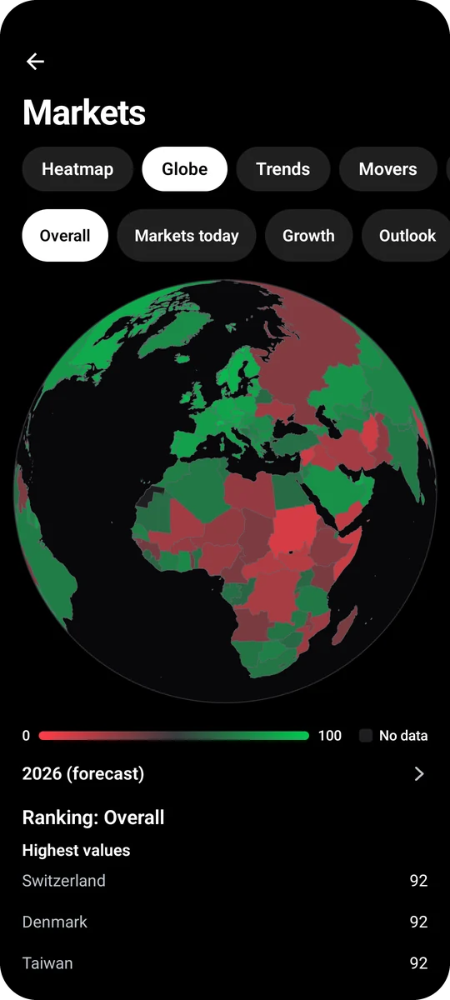
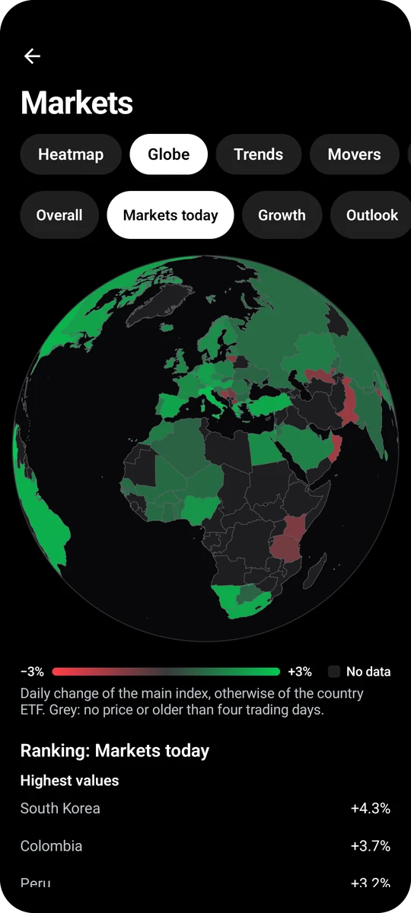
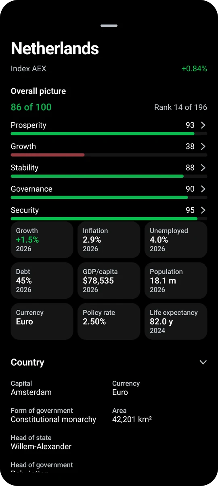
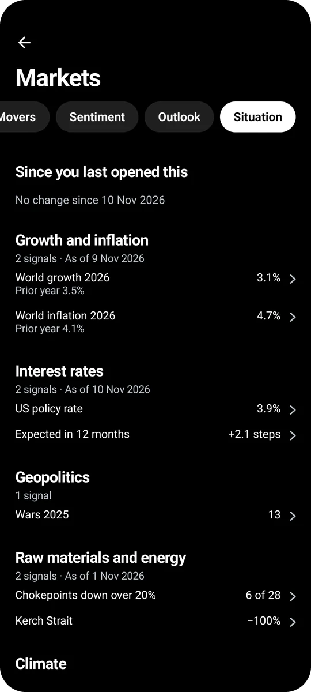
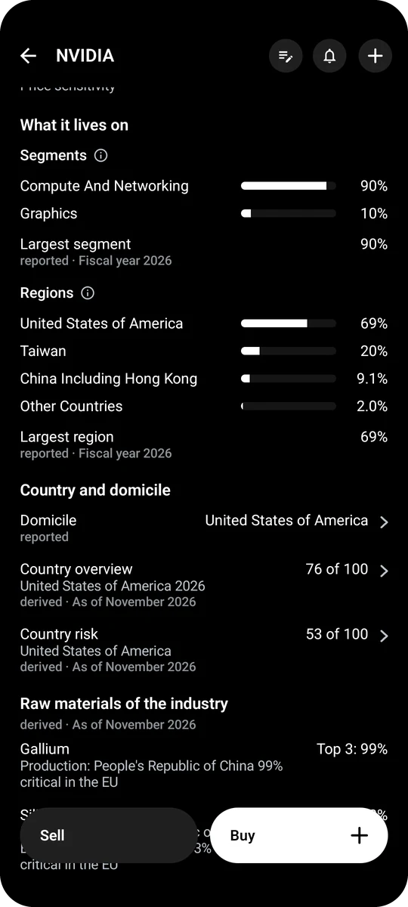
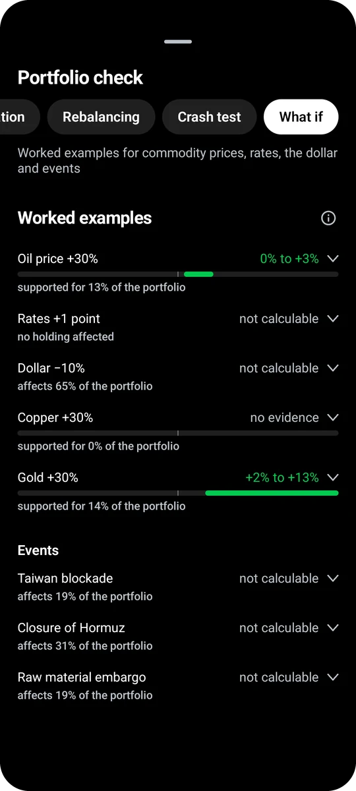

<a id="top"></a>
<p align="center"></p>

<h1 align="center">Tryfolio</h1>

<p align="center">A practice portfolio with real market prices for Android, iPhone, iPad, Windows, macOS and Linux. Trade with virtual money, follow Congress and well-known investors, and learn how investing works.</p>

<p align="center"><a href="../../releases/latest"><b>Download the latest version</b></a></p>

| Device | File in the [latest release](../../releases/latest) |
|---|---|
| Android 8.0 or later | `tryfolio-<version>.apk` |
| Windows 10 and 11 | `Tryfolio-<version>-windows-x64.msi` or without installation `…-windows-x64-portabel.zip` |
| Mac with Apple silicon | `Tryfolio-<version>-mac-arm64.zip` |
| iPhone, iPad (iOS 15 or later) | `Tryfolio-<version>-ios-unsigned.ipa`, install with SideStore, AltStore or Sideloadly |
| Debian, Ubuntu | `tryfolio_<version>_amd64.deb` |
| other Linux systems | `tryfolio-<version>-linux-x64.tar.gz` |

Free and open source (FOSS, AGPL), no sign-up, no ads, no tracking. All data stays on your device.

## Highlights

- Virtual money at live prices for stocks, ETFs and crypto, with orders, savings plans and dividends.
- Copytrading of members of Congress, the US administration and 29 well-known investors, plus insider trades.
- A 3D globe with a score for every country, stock markets of 93 countries and a sheet per country.
- The big picture: the state of the world, what a company depends on, and what an event means for your holdings.
- Markets with heatmap, sentiment, outlook and prediction markets from Polymarket and Kalshi.
- Security pages with financials, valuation and political background.
- 20 learning topics with 206 lessons, offline.

## Practice with real prices

<p align="center">


</p>

- Search with a list of recently searched securities and separate lists for stocks, ETFs, indices, commodities, currencies and crypto.
- Crypto lists by market cap, gainers and losers of the day or week, volume, distance to the 52-week high and category.
- Several named watchlists, swipe between them; the sheet always opens full height.
- Market, limit, stop and trailing stop orders, a stop sale with a linked target, and the trailing distance from the ATR.
- Savings plans and a monthly deposit of virtual money.
- One bell per security with switches for price targets, daily move, 50-day average, volume, 52-week high or low, important headlines, insider buys and sales, analyst changes, results dates, ex-dividend dates, 8-K warning signs and the buy and sell signals of a strategy-test rule, and a note per security.
- Dividends booked after tax on the payment date; interest, withholding tax and stock splits booked automatically.
- Knock-outs, factor certificates and warrants.
- An investment thesis per purchase and your own portfolio rules.
- Own risk rules as warnings in the order form: loss per trade and per day, trades per day, reward to risk; position size from the tightest of several limits.
- Import of your real transactions from a broker export.
- Own price files (Stooq text files or ZIP, Yahoo and other CSV) as fallback when the price sources return nothing and to fill gaps in old prices.
- Reconciliation with an Interactive Brokers Flex report (own token and query ID, preview of the differences before anything is booked).
- Long press a security to add it to the watchlist or as a widget.

## Security pages

<p align="center">


</p>

- Chart with your buys, sells, dividends, orders and price alerts, plus the expected 30-day price range.
- Ten indicators with explanations and a track record per security.
- Advanced chart with candles and drawing tools.
- Signals at a glance: insiders, Congress, rating changes and unusual options.
- Valuation and key figures with traffic lights, including the P/E on average earnings, valuation against the stock's own history, a fair value to calculate yourself with sliders for earnings growth and the P/E at the end, and balance sheet scores (Piotroski, Altman, Beneish).
- Number of employees over the years.
- Financials: income statement, balance sheet, cash flow, earnings per share and dividend, with CSV export.
- Earnings: the move priced in by options, the usual move and the actual one, plus the press release of the quarter and a bell on the results date.
- Analysts with the range of price targets, a bull and bear case, and the hit rate of each analyst house.
- Options: expected move per expiry, unusual contracts, premiums for selling options with the chance that they expire worthless, call and put walls, gamma exposure, volatility with IV rank, and a calculator for strategies with payoff, break-even and the sensitivities delta, gamma, theta and vega, each explained on tap. Pick an outlook, any listed expiry or your own date, and buy the strategy as warrants and shares. Every strategy goes into the portfolio in one go, sold options included, covered by shares or cash that stay bound until you buy them back or they expire.
- Short selling: short interest history, fails to deliver and the Reg SHO threshold list.
- Background for US stocks: lobbying, Congress trades, campaign contributions, layoff notices, FDA approvals and recalls, a link to the CFPB complaint database for banks and financial firms, clinical trials by phase for pharma and medtech, vehicle recalls and open investigations for carmakers, product recalls for consumer goods makers, large institutional holders with a count of all 13F funds that bought or sold.
- Company block on a stock page: one collapsed section that lists the topics with data (locations, history, backlog, auditor, litigation, layoffs, patents, emissions, government money) and shows them one below the other when opened.
- Company facts: layoff notices per quarter (WARN Act), US patents per year with technology fields and patents per R&D dollar (with your USPTO key), direct emissions of reporting facilities in the US (EPA) and the EU (Emissions Trading System, Union Registry), matched to listed parents including subsidiaries.
- Government money: what a company gets from the state in the last 12 months as contractor and as recipient of grants, payments and loans, with the change on the year before, the share of revenue, a yearly chart and the largest buyers and programs (USAspending, TED, Contracts Finder, EU budget).
- Warning signs and takeovers of US stocks from 8-K filings of the last 24 months: auditor change, restatement, delisting notice, CEO or CFO departure, bankruptcy, impairment, with insider sales in the 60 days before, and deals with the price reaction.
- Connections card on stock pages and a full-screen network: suppliers, customers, stakes, financing, competitors, board seats and government funding between companies, expandable node by node, with cycles such as stake and purchase in both directions highlighted, a statement block that reads the network, and a source link on every connection. A curated bundle covers the AI deal network; filings, GLEIF and Wikidata add connections per company. Major customers named in annual reports (SEC XBRL, shipped file) show up the other way round as suppliers of the named company, with revenue share, year and a link to the filing.
- Ownership and rights under “Background”: org chart from holders to share classes with capital and votes side by side, votes per share, what your class lets you decide, annual meeting results from 8-K filings and activist investors from Schedule 13D, with sources.
- Locations of a company: subsidiaries per country (SEC Exhibit 21, GLEIF, Wikidata), countries named in the annual report, share in high-risk countries and EU-listed tax jurisdictions, and a globe with the countries highlighted.
- History as a timeline: founding, IPO, acquisitions, renames, ticker and headquarters changes, splits, CEO changes and bankruptcy, with the price reaction on exact dates.
- Backlog of US stocks from SEC XBRL data: remaining performance obligations over the last quarters with change on the year and as a multiple of annual revenue.
- Auditor of US stocks: firm and tenure from the annual report, engagement partner and other auditors from PCAOB Form AP, going concern doubt, material weakness in Item 9A and critical audit matters.
- Litigation and penalties of US stocks: cases from the annual report, accrual from XBRL, SEC litigation releases and proceedings, and EPA environmental penalties of the last five years, plus OSHA workplace safety penalties of the last five years (with your free Department of Labor key).
- Lawsuits and judgments of any listed company: open federal cases and judgments (plaintiff or defendant, with your free CourtListener token), EU Court of Justice and General Court judgments, UK CMA cases and US Department of Justice settlements, with yearly charts of new cases and penalties.
- UK stocks: major holdings notifications (TR-1).
- ETFs: largest holdings and your look-through exposure. For US index ETFs, the gap to the index per fiscal year as the fund reported it to the SEC. Per stock, the ETFs that hold it among their ten largest positions.
- Commodities with an explanation of what moves the price, a balance of measured drivers for and against (real yield, dollar, positioning, inventories, futures curve, season, El Niño), price signals, the futures curve and options on the matching ETF. Oil with world production, consumption and inventories by country. Oil and natural gas by country: production, consumption, net exports and imports (EIA) and gas flaring estimated from satellite images (Colorado School of Mines). Gold with central bank reserves by country and the largest buyers and sellers of the last 12 months (IMF).
- Review and comparison: what an amount or savings plan would have become, compared with your portfolio, stocks, ETFs, indices, strategies, investors and politicians.
- Savings plan lookback: lump sum against instalments over every start month, and buying dips against steady saving.
- Strategy test with costs and dividends, signal rules and the 16-week rhythm, exits by stop, trailing stop, time or profit target, figures per trade, the same rule on your other securities, a parameter landscape, a comparison against randomly shifted trades, resampled price paths, rolling start dates, a savings-plan variant, a walk-forward run, a target volatility rule that sizes the position by recent volatility, the probability of backtest overfitting, the minimum track record length and a test of the best of many variants against buy and hold; the signal can come from another security and a fallback security can replace cash.
- Intraday review on 5-minute candles: opening range breakout over the last weeks and a replay of the rest of the trading day with stop and target.
- Momentum rotation across 2 to 10 securities with monthly ranking, tested against buy and hold and a benchmark index.

## Copytrading

<p align="center">


</p>

- Leaderboard: who beat the S&P 500 over the last twelve months.
- Congress buys: a strategy from all reported purchases, with a backtest.
- UK House of Commons: registered shareholdings of MPs with search by person or company; a stock's page lists MPs with a registered holding in that company.
- Administration: cabinet, Fed governors and officials with their trades.
- Presidential documents: executive orders, proclamations and memoranda of the last twelve months, matched to a stock when the title names a company or its product.
- Insiders: US Form 4 filings with filters, cluster buys and a management-only view, trends for many other countries.
- Executive pay: CEO pay and pay actually received from the proxy statement against the share return, last five years.
- Rare insider buys, an “Overlaps” list of stocks that insiders, Congress and funds buy at once, and an insider simulator under “Track record” with adjustable rules for cluster buys (several executives of a company buy their own shares within days).
- Congress by sector: buys and sells by sector over 90 days, with the delay between trade and filing.
- Party, committees, assets, debts and the original PDFs per person.
- Copy a person or strategy with an amount or as savings plans, with a bell for new filings.
- All 13F funds of a quarter: the most bought and most sold stocks, plus a search for any other fund.
- Compare portfolios in one chart.
- Ranking of the model portfolios by return, volatility, drawdown and Sharpe ratio per period.
- Overview per group: largest holdings by total value, most traded stocks, and stocks below the entry price of members of Congress, the administration and investors. A stock's page lists the insiders who bought on the market and now sit below their entry price, with sales taken into account.

## Markets

<p align="center">


</p>

- Heatmap of the 500 largest companies, your portfolio or an index, from one day to one year.
- What moves the index: the stocks that add or take the most, in index points.
- Theme baskets such as AI or defence with their breadth; sectors with P/E and dividend yield.
- Movers with relative volume, IPOs, earnings, ex-dividend dates and stock splits with calendars; an IPO overview with the largest offerings. Each IPO sheet compares the first trading day with other recent IPOs, shows how other IPOs stood against their issue price after one month, six months and one year, and lists shareholders, banks and the lock-up period from the SEC prospectus. A Lock-ups tab lists recent IPOs whose lock-up ends within 90 days.
- Sentiment: overall gauge, Fear & Greed, retail mood, put/call ratio, early warning signs with a look-back on how they stood before past crashes, price against trading volume, and futures positioning.
- Outlook: an overall verdict with a balance of all signals, a phase counter of seven market factors, then interest rates with the Fed's own rate projections (dot plot) next to the market's expected path, recession, inflation and oil with Polymarket bets, plus an economic calendar and patterns of the past, including the winter half-year against the summer half-year compared with staying invested.
- What the numbers mean: each economic release with its surprise and the usual chain to rates, currency and sectors, checked against the day's market reaction.
- Yield curves, VIX curve, sector rotation and most discussed stocks on Reddit.
- Breakthroughs per topic with strict filtering, expected milestones, work in progress, a look back and fields that speed themselves up, with matching ETFs.
- Inventories and economic data, with a bubble detector; each bubble sign opens a card with its thresholds on a scale, past peaks such as 1929, 2000 and 2021, and its history where the source provides one. Bottom signs cover the opposite case. Both look back: how the bottom signs stood at each major S&P 500 low since 1932, false alarms included, and which bubble signs were on red at each high before a decline since 1929. A monthly four-factor rule (rates, inflation, dollar, season) says invested or not invested.

## The world on a globe

<p align="center">



</p>

- Overall score from 0 to 100 for every country from prosperity, growth, stability, governance and security, with a ranking of all states.
- Stock markets of 93 countries in one view, plus growth, inflation, unemployment, debt, business cycle and trading hours.
- Time slider back to 2000 and forward along the IMF forecast, country names as you zoom in.
- Country sheet: the five parts of the score, charts for the economy, sectors and companies, largest listed and unlisted companies, structural problems and the programs against them, debt sustainability, policy rate history with the latest moves, risks, ratings, elections, sanctions and trade, price level and purchasing power against your own country, currency strength, the Big Mac index and rankings such as the Human Development Index.
- Your portfolio on the globe by country of operation, with or without ETFs, and a summary of how spread out it is.
- Chokepoints such as Hormuz, Bab el-Mandeb, Suez, Panama and the Taiwan Strait, El Niño and rising tensions.
- Conflicts since 1946 and geopolitical risk since 1900 per country sheet, with war years and the longest run without a break.

## The big picture

<p align="center">



</p>

- State of the world in six topics: economy and inflation, interest rates, geopolitics, commodities and energy, climate, technology.
- Political uncertainty: geopolitical risk since 1900, economic policy uncertainty and stock market news, each ranked against all months of its series.
- Outlook: implied equity risk premium since 1961 next to the 10-year US yield.
- Per stock, what it lives on: revenue by segment, region and major customer from the annual report, for companies that file with the SEC.
- Per stock, what it depends on: country and parent company, raw materials of its industry and who mines them, chokepoints, tensions and policy programs.
- Per stock: P/E against the US industry with the industry history since 2015, and the tone of news coverage against the two months before.
- How the price has moved with oil, interest rates, the dollar, copper, gold and the chip cycle, shown only where the link holds up.
- What does this mean for me: from an event such as a blocked strait to the holdings it touches.
- What if: oil, copper and gold moves as a range for your portfolio, and events such as a Taiwan blockade with the holdings affected.
- Look-back: how the warning signs stood before every crash since 1927, with hits and false alarms.

## Stock finder

<p align="center">

</p>

- Scores from 0 to 100 for valuation, quality, market power, analysts, price trend, insiders, short selling and Reddit, with adjustable weights.
- Best stocks per industry and a suggested portfolio of single stocks, spread across industries, sectors and countries.
- Markets from all stocks to single regions and 20 indices.
- Filters for industry, region, country, size, dividend and score.
- 42 templates, among them screens of well-known investors and setups such as a pullback in an uptrend, results as CSV.
- Scan for price patterns on daily closes: new 20-day high, bull flag, back above the 20-day average, RSI oversold and RSI reversal.
- Backtest of the scoring against the index members of the time, compared with 1,000 random portfolios from the same index.
- Radar for early signs such as Reddit mentions, insider group purchases and unusual volume.

## Portfolio analytics

<p align="center">

</p>

- Returns (time-weighted and IRR) for the portfolio and each security, drawdown, volatility, Sharpe and Sortino ratio and capital account, with a table of the largest drawdowns, up and down capture, Omega and gain to pain.
- Portfolio check with traffic lights and risk contribution per holding.
- Return and risk of every holding in one chart, underwater chart, distribution of returns, rolling figures and a currency shock.
- Investor profile and self-check.
- Portfolio history after inflation, compared with eight indices, with closed sales by holding period and trigger.
- Monthly grid of returns: years as rows, months as columns, coloured by monthly return with the yearly return on the right, for the portfolio and for every stock or index.
- Crash test, also for a test portfolio, Monte Carlo simulations and dividend calendar.
- Factor breakdown: loadings of the portfolio on market, size, value, quality and momentum with their uncertainty, overall and rolling, and the unexplained return per year.
- Rebalancing with your own categories and target weights set by tapping a row, and a list of whole shares to buy and sell with the remaining cash.
- Selling options (where the premium is highest), unusual contracts, the options calculator and new analyst ratings for your holdings and watchlist, and a ranking of analyst houses by hit rate.
- Withdrawal plan: target wealth and years to reach it, withdrawal rules tested on every start year since the 1870s, with German tax as an option.
- Beating the market: studies on funds, stock returns, day trading and CFD accounts as charts, each figure with its source, and published return patterns in their study sample against the years after publication.
- Leverage simulator: what daily reset leverage would have made of any price series, with financing, costs and path loss, short as negative leverage, and the same leverage through the big crises.
- Efficient frontier of your holdings with lowest volatility, highest Sharpe ratio and equal weighting, as a look back.
- Portfolio backtest: up to three mixes of securities with rebalancing rules, costs and a savings rate against an index, with the return by holding period.
- Market history: up to three mixes (such as 60/40, the Permanent Portfolio, All Weather or the Golden Butterfly) of stocks, bonds, money market and gold side by side, in real terms since 1871, with the deepest decline and the spread of returns by holding period.
- Exchange rates since 1971 in the market history: the US dollar in euro (D-mark before 1999), pound, yen, franc and Canadian dollar, with high, low and change.
- Trading calendar with a daily review for every past day, also for imported portfolios.

## Prediction markets

<p align="center">

</p>

- Bets with practice money on Polymarket and Kalshi, sold early at any time.
- Biggest bets by topic and notable bets of successful traders.
- Manifold (play money) and Metaculus (community forecast, own token required) as further sources, shown separately and marked as such.
- Your public Polymarket address shows your real positions, read only.

## News and learning

<p align="center">


</p>

- Headlines from financial news, central banks and authorities, per market and per stock, in English optionally from English sources only.
- Original article or text only view.
- Your own RSS and Atom feeds as extra categories, search and bookmarks.
- Daily review at a time you choose, weekly review on Fridays.
- Notifications by type, each with its own switch, and all bells (securities and copytrading people) in one list.
- 20 learning topics with 206 lessons, charts and calculators, offline, in German and English. Lessons on key figures show an example with today's values.
- Track record: insider clusters, sold puts, Congress trades, IPOs and the 16-week rhythm checked against the data.

## Widgets and desktop

<p align="center">

</p>

- 47 Android home screen widgets, including sentiment, globe with tappable countries, heatmap, bubble risk, outlook, sectors, Congress by sector, overlaps, portfolio with chart, selling options, warning signs, lessons, stock finder, watchlist, markets, movers and orders.
- Long press a tile on the start page, a tab or a heading in the app to add a matching widget, set to what you are looking at.
- Desktop version for Windows, macOS and Linux with the same features.
- Appearance: system, light, dark or sepia; logos in color or black and white, round or square; dividers on or off.
- A portfolio moves between phone and computer as a file.

## Installation

<details>
<summary><b>Notes for Windows, Mac and Linux</b></summary>

- The packages are not signed. Windows asks via SmartScreen on first start ("More info", then "Run anyway").
- Mac: control-click `Tryfolio.app` on first start and choose "Open". If macOS says the app is damaged, run `xattr -dr com.apple.quarantine Tryfolio.app` in Terminal.
- Debian and Ubuntu: `sudo apt install ./tryfolio_<version>_amd64.deb`.
- Checksums are in `SHA256-windows.txt`, `SHA256-linux.txt` and `SHA256-mac.txt`.
- Desktop data: Windows `%APPDATA%\Tryfolio`, macOS `~/Library/Application Support/Tryfolio`, Linux `~/.local/share/tryfolio`.
- A daily check for new versions can be switched off in the profile under notifications.
</details>

<details>
<summary><b>iPhone and iPad</b></summary>

- The IPA is not signed. SideStore, AltStore or Sideloadly sign it with your own Apple ID while installing it.
- Sideloadly on Windows needs iTunes and iCloud from Apple's website, not from the Microsoft Store.
- On the iPhone, trust your own profile under Settings → General → VPN & Device Management. From iOS 16 on, also turn on Developer Mode.
- With a free Apple ID the installation lasts 7 days, then refresh it or install it again. At most 3 such apps can be installed at a time.
- Not yet on iOS: app lock, widgets and notifications in the background.
</details>

<details>
<summary><b>Building</b></summary>

Requirements: JDK 17 and the Android SDK.

```sh
./gradlew :app:testDebugUnitTest :app:lintDebug :app:assembleDebug   # Android (assembleRelease needs TROETE_KEYSTORE_DATEI, or -PdebugSigniert=true for a local test build)
./gradlew :desktop:run                  # start the desktop app
./gradlew :desktop:test                 # tests and a walk through the interface without a window
./gradlew :desktop:createDistributable  # program folder with its own Java runtime
./gradlew :desktop:packageMsi           # Windows installer (downloads WiX)
./gradlew :desktop:packageDeb           # Debian package, Linux only
```

On Windows use `gradlew.bat`. How the app is tested is described in [docs/QA.md](docs/QA.md) (in German).

| Directory | Contents |
|---|---|
| `app/src/main/java/…/ui` | Compose interface |
| `…/engine` | calculation logic |
| `…/market` | prices, news, prediction markets, copytrading |
| `…/data`, `…/i18n` | models, storage, German and English |
| `app/src/main/assets` | learning section, catalogue, bundled data |
| `app/src/android/java` | Android platform layer |
| `desktop` | Windows, macOS and Linux |
| `tools` | scripts for filings and signing the source list |
| `app/src/test` | tests |
</details>

<details>
<summary><b>Limitations</b></summary>

- Orders, savings plans and the monthly deposit run while the app is open. The next start makes up for limit, stop and trailing stop orders, savings plans and deposits in between from the price history.
- Prices come from an unofficial Yahoo Finance interface and may be delayed.
- Indicators only describe past prices.
- Congress filings give amounts as ranges and are reported up to 45 days late. Paper filings are read by text recognition, and unreadable rows are missing.
- Outside the US, Germany and the large European registers, amounts are read from forms, and unreadable forms are missing.
- 13F data covers listed US securities at quarter end, without short positions.
- Prediction market bets use practice money at the displayed price, without fees or market depth.
- MarketWatch articles need an embedded browser on a computer, downloaded on first use if you agree.
- Desktop notifications work only while the app is open. The Mac version is not notarised by Apple.
</details>

<details>
<summary><b>Data sources and use</b></summary>

Prices, company data, option chains, news and filings come from third parties at runtime and are not covered by this app's licence. The terms of each source apply.

- Prices, ETF holdings, annual reports, similar stocks and stock splits: Yahoo Finance.
- Calendars for IPOs, earnings, dividends, stock splits and economic data: Nasdaq. Earnings estimates in the overview per company: Nasdaq and Yahoo Finance.
- Congress and administration filings: Clerk of the US House of Representatives, Senate eFD system, U.S. Office of Government Ethics and whitehouse.gov. Under 5 U.S.C. § 13107 they must not be used for commercial purposes, for establishing anyone's credit rating or for soliciting money. The app is a free learning and practice program.
- Newer Senate filings: Congress Trading Monitor (MIT).
- UK Register of Members' Financial Interests: contains Parliamentary information licensed under the Open Parliament Licence v3.0.
- Investors: 13F data from the SEC (EDGAR, Form 13F data sets) and 13f.info, tickers from OpenFIGI.
- Insiders: SEC Form 345 data sets and EDGAR, BaFin, Finansinspektionen, Autorité des marchés financiers, Autoriteit Financiële Markten, SIX Exchange Regulation and further registers fetched on the device for personal use only; UK director dealings and major holdings notifications (TR-1) via Investegate after a one-time confirmation as a private investor; Denmark, Finland, Iceland and the Baltic states via the Nasdaq Nordic news interface; Hong Kong as a link. Lists you download yourself (for example BSE India, Consob, Bundesanzeiger, FCA short positions, Qatar) can be imported and stay on the device.
- Politics and agencies: EU Transparency Register, German Bundestag, HATVP, USAspending.gov, FEC, WARN Feed (CC BY 4.0), openFDA (CC0), ClinicalTrials.gov (U.S. National Library of Medicine), NHTSA, CPSC, CFPB, Federal Register, FINRA.
- News: tagesschau.de, Yahoo Finance, Google News, CNBC, Reuters (optional, off by default, headline and link only), MarketWatch, BBC News, n-tv, Süddeutsche Zeitung, Handelsblatt, The New York Times, derStandard.at, DER AKTIONÄR, Nasdaq, finanznachrichten.de, The Defiant, Decrypt, ECB, Federal Reserve, Bank of England, Deutsche Bundesbank, Swiss National Bank, BIS, Destatis, European Commission, BEA, BaFin, EIA, blogs and letters. English-language additions, off by default until chosen: CBC News, Channel NewsAsia, Hindustan Times, Bank of Canada, ECB blog, Federal Reserve speeches, EIA press releases, US Department of Energy; headline, short summary and link only.
- Prediction markets: Polymarket and Kalshi; Manifold (play money) and, with your own token, Metaculus (community forecasts) for display only.
- Crypto background: funding rates and open interest from Kraken Futures, with Deribit as fallback; stablecoin supply and total value locked from DefiLlama. Fetched on the device for personal use, nothing is stored.
- Globe and countries: country outlines from Natural Earth (public domain), economic figures from the IMF World Economic Outlook (DataMapper), World Bank (CC BY 4.0), United Nations (CC BY 3.0 IGO) and the CIA World Factbook, conflicts from UCDP (CC BY 4.0), sanctions from OpenSanctions (CC BY-NC 4.0), trade from UN Comtrade, disasters from GDACS, chokepoints from IMF PortWatch, tensions from GDELT, El Niño from NOAA, country facts from Wikidata (CC0) and Wikipedia (CC BY-SA 4.0), electricity generation and consumption in Germany from SMARD ("Bundesnetzagentur | SMARD.de", CC BY 4.0) and, with your own token, day-ahead power prices from the ENTSO-E Transparency Platform. Index quotes from Yahoo Finance and, where Yahoo carries none, directly from the exchange.
- Dependencies: annual reports from the SEC (EDGAR), parent companies from GLEIF (CC0), raw materials from the U.S. Geological Survey (Minerals Yearbook, Mineral Commodity Summaries), World Nuclear Association and World Bank prices (CC BY 4.0), world oil production, consumption and inventories from the U.S. Energy Information Administration (Short-Term Energy Outlook, public domain), central bank gold reserves from the International Monetary Fund (IRFCL), company facts from Wikidata (CC0).
- Long-run country history: returns, inflation, credit and crisis years since 1870 from the Jordà-Schularick-Taylor Macrohistory Database (CC BY-NC-SA 4.0, non-commercial use, derived data shared under the same terms, see NOTICE) and real house prices and incomes since 1975 from the Federal Reserve Bank of Dallas International House Price Database (not for private gain, credited to the Bank, see NOTICE).
- Early Bitcoin prices: daily closes from July 2010 until the regular price history starts in September 2014, used in the strategy test, from Coin Metrics Community Data (CC BY-NC 4.0, non-commercial use, see NOTICE).
- Lifetime returns of US stocks since 1926 in Beating the market: distribution by class, counted from the table by Hendrik Bessembinder (Arizona State University); no single-stock figures are included.
- Very long country series: consumer prices, short-term rates and government bond yields for Sweden from 1290 from Sveriges Riksbank, Historical Monetary Statistics of Sweden, and for Norway from 1516 from Norges Bank, Historical Monetary Statistics for Norway (see NOTICE).
- Currency and purchasing power: price levels and purchasing power parity from IMF World Economic Outlook figures, exchange rates and real effective exchange rates from the World Bank (CC BY 4.0), the Big Mac index from The Economist (CC BY 4.0), the Human Development Index and related indices from the UNDP Human Development Report (CC BY 3.0 IGO), Gini, logistics and human capital indices from the World Bank (CC BY 4.0).
- Gap to the index of US index funds: Form N-CEN data sets from the SEC.
- Fed rate projections (dot plot): Summary of Economic Projections from the Federal Reserve.
- Policy rates: history per country and the latest rate moves from the BIS (central bank policy rates, source: BIS).
- Debt sustainability: government revenue, interest payments, nominal growth, reserves and short-term external debt from the World Bank (CC BY 4.0), government debt from the IMF World Economic Outlook.
- Geopolitical risk and policy uncertainty: Geopolitical Risk Index by Caldara and Iacoviello (CC BY), Economic Policy Uncertainty by Baker, Bloom and Davis (CC BY 4.0). Conflicts since 1946: UCDP/PRIO Armed Conflict Dataset (CC BY 4.0). Industry P/E and implied equity risk premium: Aswath Damodaran, NYU Stern. Tone of coverage: GDELT Project.
- Look-back on warning signs: Robert Shiller's online data, OECD (CC BY 4.0), Federal Reserve Bank of Chicago, BLS.
- Factor breakdown: Kenneth R. French Data Library (Copyright Eugene F. Fama and Kenneth R. French) and Global Factor Data by Jensen, Kelly and Pedersen (CC BY-NC 4.0), both fetched on the device.
- Look-back of the stock finder: members of the S&P 500 since 1996 from fja05680/sp500 (MIT, Copyright (c) 2019-2020 Farrell J. Aultman), members of the Nasdaq-100 since 2007 from jmccarrell/n100tickers (MIT, Copyright (c) 2021 - 2025 Jeff McCarrell).
- Recession shading in long charts and the recession probability from the yield curve: Federal Reserve Bank of New York (© Federal Reserve Bank of New York, Terms of Use at newyorkfed.org), with the recession months as dated by the NBER.
- Running estimate of US growth in the current quarter (GDPNow): © Federal Reserve Bank of Atlanta, read from the spreadsheet on atlantafed.org, with FRED as fallback (copyrighted, citation required; fetched on the device, not bundled, not stored).
- FRED series are shown with the citation FRED asks for (owner, series, retrieved from FRED, Federal Reserve Bank of St. Louis) and are held in memory only while a view is open, never stored.
- Sentiment and markets: CNN Fear & Greed Index (unofficial interface), alternative.me, AAII, Cboe, Cboe Futures Exchange (VX futures settlement prices for the VIX futures curve), CFTC (Commitments of Traders), US Treasury, ECB, Deutsche Bundesbank, BLS, FRED (including the ICE BofA high-yield spread of ICE Data Indices and University of Michigan consumer sentiment from the Surveys of Consumers), EIA, TSA, U.S. Drought Monitor, World Bank, ApeWisdom, Wikimedia.
- Party, committees and current members of Congress: unitedstates/congress-legislators and Wikidata (CC0). Profile pictures: unitedstates.github.io and Wikimedia Commons.
- Optional with your own key: The Guardian, Finnhub, Alpha Vantage, DeepL, Reddit, CourtListener, Bluesky, USPTO, GIE AGSI+, ENTSO-E (wholesale power prices per country on the country sheet), EODHD, Massive (formerly Polygon.io), Tiingo and Twelve Data (fallbacks for US prices, tried in this order when the main price source returns nothing; Tiingo also supplies splits and dividends). Explain assistant: Anthropic or any OpenAI-compatible provider. The same page collects everything you load, read in or open in the browser yourself.

The app is not affiliated with any of these providers. The daily check for a new version goes to the GitHub API and carries only the app's identifier. SEC requests carry the app name and a contact address in the User-Agent: a random placeholder on the reserved domain example.org is generated once per installation, a contact address you enter under Access replaces it and goes only to the SEC, and without a valid address the app sends no SEC requests.

The app is not investment advice. The portfolio is virtual. The app does not collect usage data, and all data stays on the device. The optional explain assistant sends the figures of the open page, without your portfolio, to the provider you set up.
</details>

## Licence

Free and open source software (FOSS) under the GNU Affero General Public License, version 3 or later (AGPL-3.0-or-later), see [LICENSE](LICENSE). Anyone who passes on the app or a modified version, including as a network service, must make the source code available under the same licence.

The bundled photos, the screenshots in `docs/bilder` and the data loaded at runtime keep their own licences and terms. Authors, licences and sources are listed in [NOTICE](NOTICE).

The libraries inside the app packages keep their own licences as well (Apache 2.0, BSD, MIT, MPL 2.0 and, for the Java runtime of the desktop packages, GPL 2.0 with the Classpath Exception). They are listed in [NOTICE](NOTICE), their full licence texts are in [THIRD_PARTY_LICENSES.txt](THIRD_PARTY_LICENSES.txt) and in the app under About.

---

<p align="center"><a href="https://buymeacoffee.com/regard2462"></a></p>
