<a id="top"></a>
<p align="center">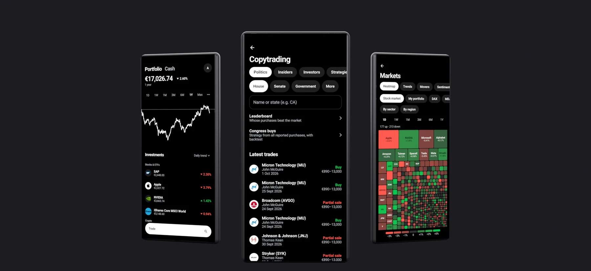</p>

<h1 align="center">Tryfolio</h1>

<p align="center">A practice portfolio with real market prices for Android, iPhone, iPad, Windows, macOS and Linux. Trade with virtual money, follow Congress and well-known investors, and learn how investing works.</p>

<p align="center"><a href="../../releases/latest"><b>Download the latest version</b></a></p>

| Device | File in the [latest release](../../releases/latest) |
|---|---|
| Android 8.0 or later | `tryfolio-<version>.apk` |
| Windows 10 and 11 | `Tryfolio-<version>-windows-x64.msi` or without installation `…-windows-x64-portabel.zip` |
| Mac with Apple silicon | `Tryfolio-<version>-mac-arm64.zip` |
| iPhone, iPad (iOS 15 or later) | `Tryfolio-<version>-ios-unsigned.ipa`, install with SideStore, AltStore or Sideloadly |
| Debian, Ubuntu | `tryfolio_<version>_amd64.deb` |
| other Linux systems | `tryfolio-<version>-linux-x64.tar.gz` |

Free and open source (FOSS, AGPL), no sign-up, no ads, no tracking. All data stays on your device.

## Highlights

- Virtual money at live prices for stocks, ETFs and crypto, with orders, savings plans and dividends.
- Copytrading of members of Congress, the US administration and 29 well-known investors, plus insider trades.
- Markets with heatmap, sentiment, outlook and prediction markets from Polymarket and Kalshi.
- Security pages with financials, valuation and political background.
- 20 learning topics with 206 lessons, offline.

## Practice with real prices

<p align="center">
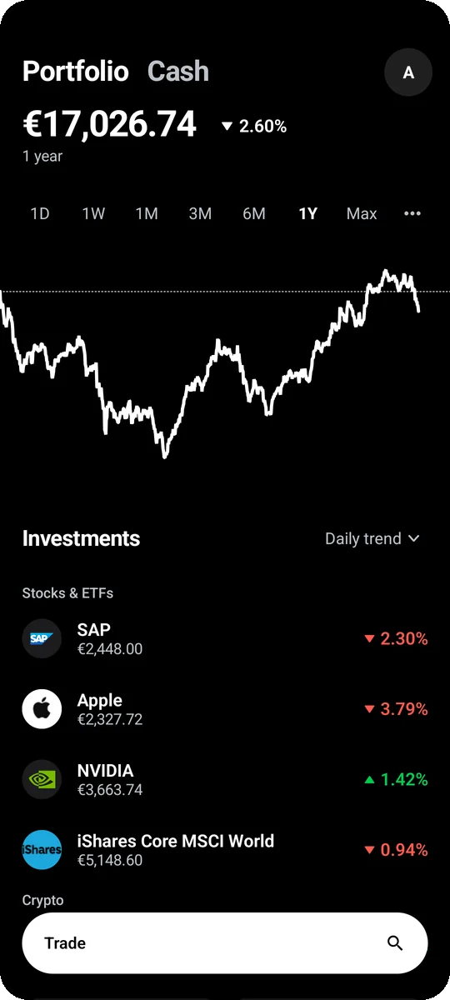
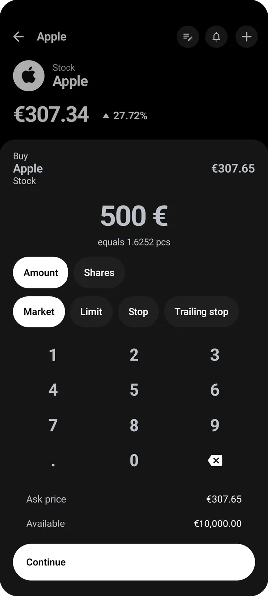
</p>

- Search with a list of recently searched securities.
- Market, limit, stop and trailing stop orders.
- Savings plans and a monthly deposit of virtual money.
- Price alerts and a note per security.
- Dividends, interest and withholding tax, stock splits booked automatically.
- Knock-outs, factor certificates and warrants.
- An investment thesis per purchase and your own portfolio rules.
- Import of your real transactions from a broker export.

## Security pages

<p align="center">
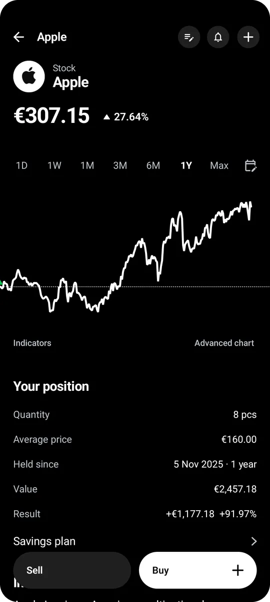
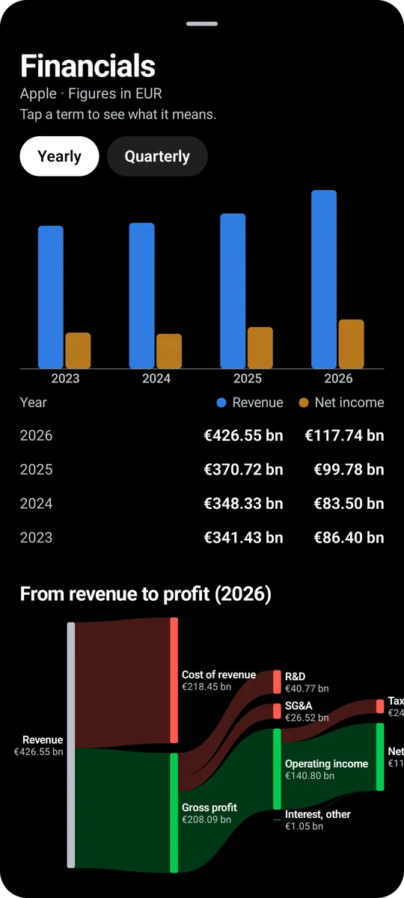
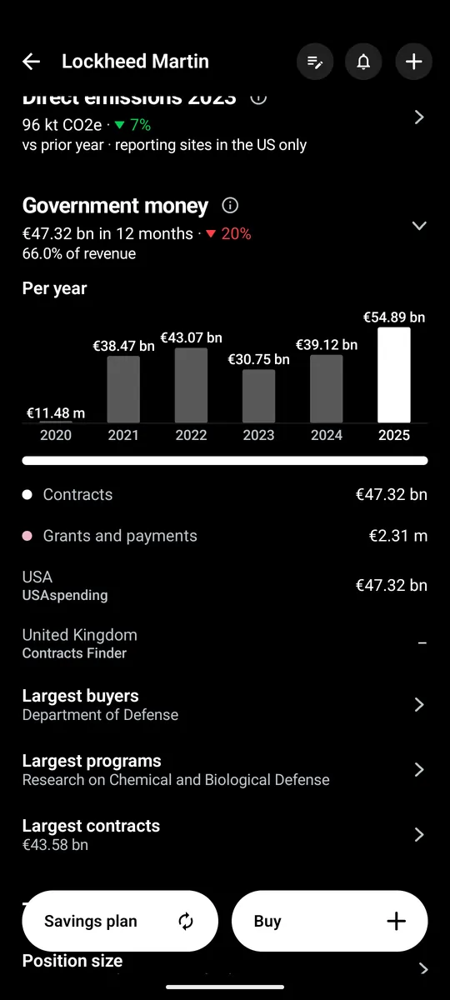
</p>

- Chart with your buys, sells, dividends, orders and alerts, plus the expected 30-day price range.
- Ten indicators with explanations and a track record per security.
- Advanced chart with candles and drawing tools.
- Valuation and key figures with traffic lights.
- Financials: income statement, balance sheet, cash flow, earnings per share and dividend.
- Analysts, options, short selling, and a bull and bear case.
- Background for US stocks: lobbying, Congress trades, federal contracts, campaign contributions, layoff notices, FDA approvals and recalls, large institutional holders.
- UK stocks: major holdings notifications (TR-1).
- ETFs: largest holdings and your look-through exposure.
- Commodities with an explanation of what moves the price.
- Look back: what an amount or savings plan would have become, compared with your portfolio, stocks, ETFs, indices, strategies, investors and politicians.

## Copytrading

<p align="center">
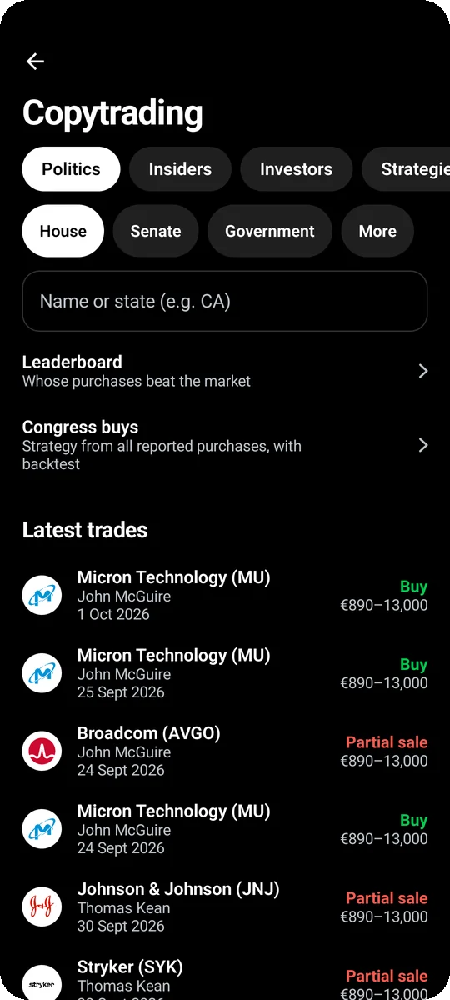
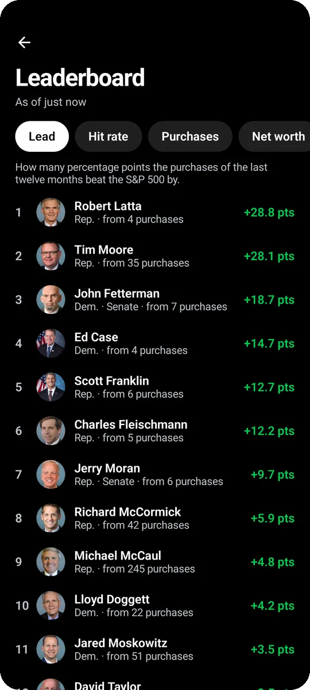
</p>

- Leaderboard: who beat the S&P 500 over the last twelve months.
- Congress buys: a strategy from all reported purchases, with a backtest.
- Administration: cabinet, Fed governors and officials with their trades.
- Insiders: US Form 4 filings with filters and cluster buys, trends for many other countries.
- Party, committees, assets, debts and the original PDFs per person.
- Copy a person or strategy with an amount or as savings plans, with a bell for new filings.
- Compare portfolios in one chart.

## Markets

<p align="center">
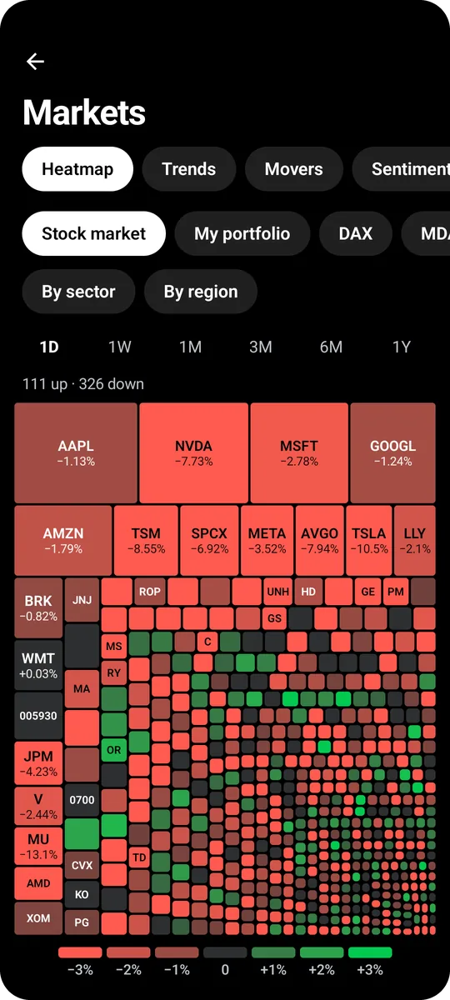
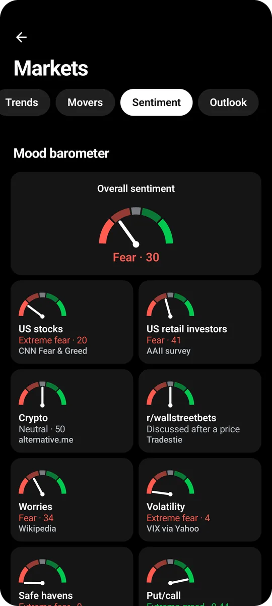
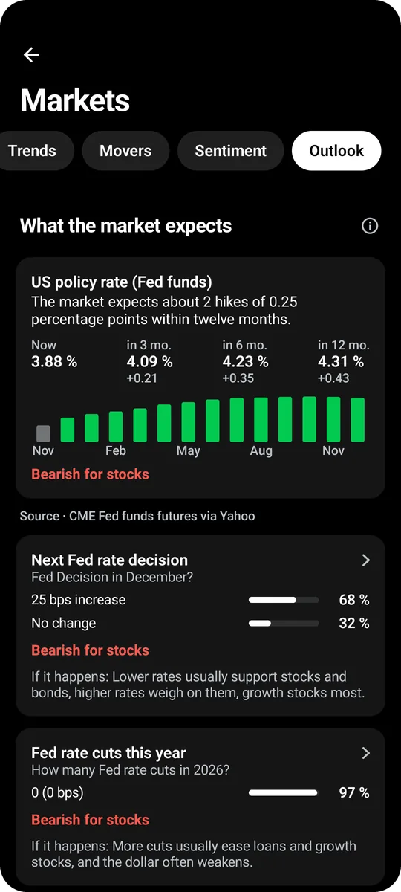
</p>

- Heatmap of the 500 largest companies, your portfolio or an index, from one day to one year.
- Movers, IPOs, earnings, ex-dividend dates and stock splits with calendars.
- Sentiment: overall gauge, Fear & Greed, retail mood, put/call ratio, early warning signs and futures positioning.
- Outlook: interest rates, recession, inflation and oil with Polymarket bets, plus an economic calendar.
- Yield curves, VIX curve, sector rotation and most discussed stocks on Reddit.
- Inventories and economic data, with a bubble detector.

## Stock finder

<p align="center">
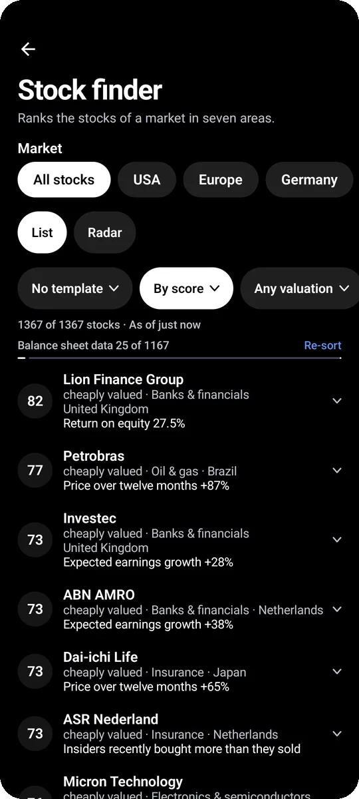
</p>

- Scores from 0 to 100 for valuation, quality, analysts, price trend, insiders, short selling and Reddit, with adjustable weights.
- Markets from all stocks to single regions and 20 indices.
- Filters for industry, region, country, size, dividend and score.
- 20 templates based on the finviz screeners.
- Backtest of the scoring.
- Radar for early signs such as Reddit mentions, insider group purchases and unusual volume.

## Portfolio analytics

<p align="center">
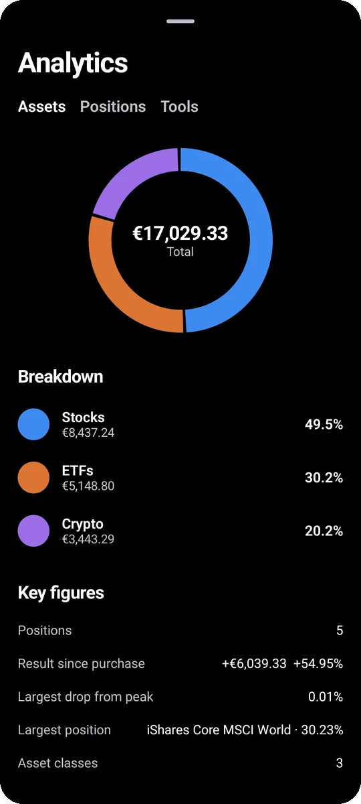
</p>

- Returns (time-weighted and IRR), drawdown, volatility and capital account.
- Portfolio check with traffic lights and risk contribution per holding.
- Investor profile and self-check.
- Portfolio history after inflation.
- Crash test, Monte Carlo simulations and dividend calendar.

## Prediction markets

<p align="center">
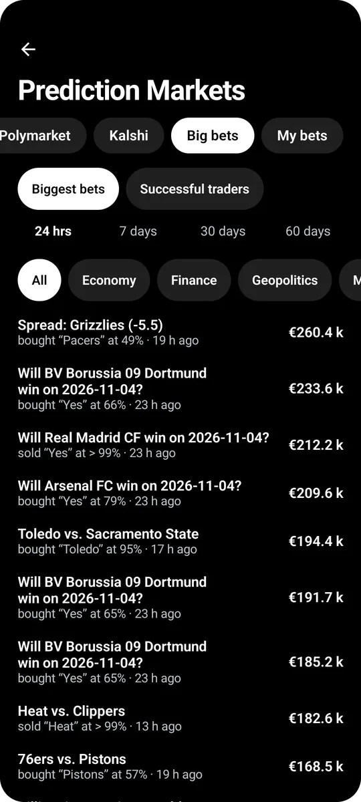
</p>

- Bets with practice money on Polymarket and Kalshi, sold early at any time.
- Biggest bets by topic and notable bets of successful traders.
- Your public Polymarket address shows your real positions, read only.

## News and learning

<p align="center">
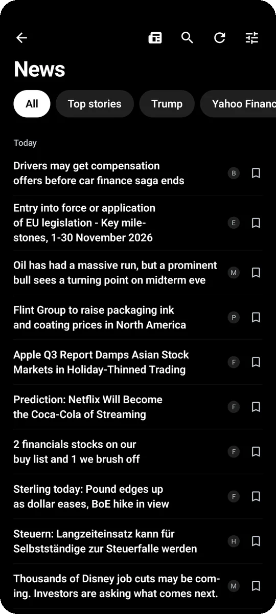
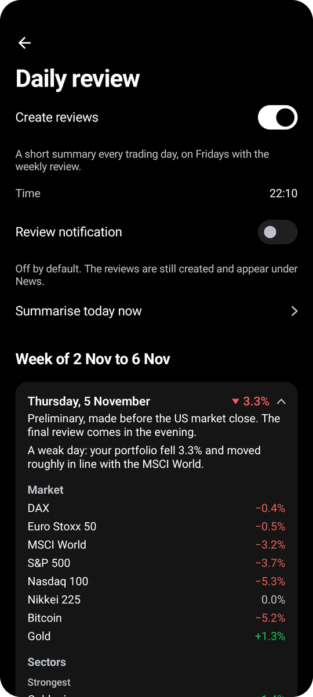
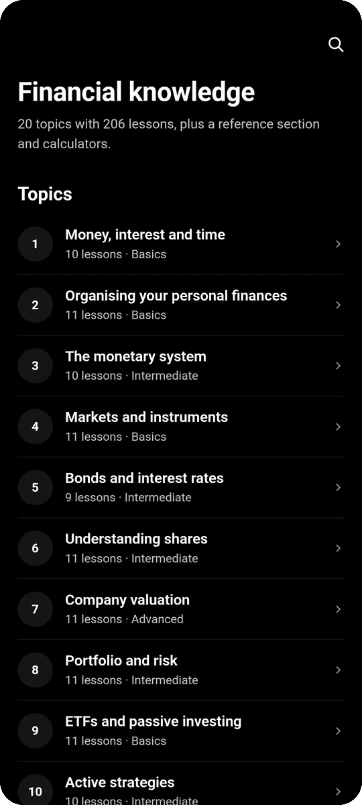
</p>

- Headlines from financial news, central banks and authorities, per market and per stock.
- Original article or text only view.
- Your own RSS and Atom feeds as extra categories, search and bookmarks.
- Daily review at a time you choose, weekly review on Fridays.
- Notifications by type, each with its own switch.
- 20 learning topics with 206 lessons, charts and calculators, offline, in German and English.

## Widgets and desktop

<p align="center">
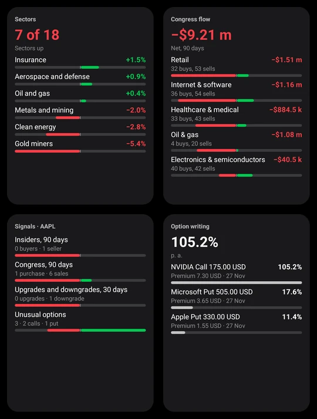
</p>

- Ten Android home screen widgets, including portfolio, watchlist, markets, heatmap, dividends and headlines.
- Desktop version for Windows, macOS and Linux with the same features.
- A portfolio moves between phone and computer as a file.

## Installation

<details>
<summary><b>Notes for Windows, Mac and Linux</b></summary>

- The packages are not signed. Windows asks via SmartScreen on first start ("More info", then "Run anyway").
- Mac: control-click `Tryfolio.app` on first start and choose "Open". If macOS says the app is damaged, run `xattr -dr com.apple.quarantine Tryfolio.app` in Terminal.
- Debian and Ubuntu: `sudo apt install ./tryfolio_<version>_amd64.deb`.
- Checksums are in `SHA256-windows.txt`, `SHA256-linux.txt` and `SHA256-mac.txt`.
- Desktop data: Windows `%APPDATA%\Tryfolio`, macOS `~/Library/Application Support/Tryfolio`, Linux `~/.local/share/tryfolio`.
- A daily check for new versions can be switched off in the profile under notifications.
</details>

<details>
<summary><b>iPhone and iPad</b></summary>

- The IPA is not signed. SideStore, AltStore or Sideloadly sign it with your own Apple ID while installing it.
- Sideloadly on Windows needs iTunes and iCloud from Apple's website, not from the Microsoft Store.
- On the iPhone, trust your own profile under Settings → General → VPN & Device Management. From iOS 16 on, also turn on Developer Mode.
- With a free Apple ID the installation lasts 7 days, then refresh it or install it again. At most 3 such apps can be installed at a time.
- Not yet on iOS: app lock, widgets and notifications in the background.
</details>

<details>
<summary><b>Building</b></summary>

Requirements: JDK 17, Android SDK 35 with build tools 35.0.0. AGP 8.7.3, Kotlin 2.1.0, Gradle 8.9, Compose Multiplatform 1.7.3; minSdk 26, targetSdk 35.

```sh
./gradlew :app:testDebugUnitTest :app:lintDebug :app:assembleRelease   # Android
./gradlew :desktop:run                  # start the desktop app
./gradlew :desktop:test                 # tests and a walk through the interface without a window
./gradlew :desktop:createDistributable  # program folder with its own Java runtime
./gradlew :desktop:packageMsi           # Windows installer (downloads WiX)
./gradlew :desktop:packageDeb           # Debian package, Linux only
```

On Windows use `gradlew.bat`. How the app is tested is described in [docs/QA.md](docs/QA.md) (in German).

| Directory | Contents |
|---|---|
| `app/src/main/java/…/ui` | Compose interface |
| `…/engine` | calculation logic |
| `…/market` | prices, news, prediction markets, copytrading |
| `…/data`, `…/i18n` | models, storage, German and English |
| `app/src/main/assets` | learning section, catalogue, bundled data |
| `app/src/android/java` | Android platform layer |
| `desktop` | Windows, macOS and Linux |
| `tools` | scripts for filings and signing the source list |
| `app/src/test` | tests |
</details>

<details>
<summary><b>Limitations</b></summary>

- Orders and savings plans run while the app is open.
- Prices come from an unofficial Yahoo Finance interface and may be delayed.
- Indicators only describe past prices.
- Congress filings give amounts as ranges and are reported up to 45 days late. Paper filings are read by text recognition, and unreadable rows are missing.
- Outside the US, Germany and the large European registers, amounts are read from forms, and unreadable forms are missing.
- 13F data covers listed US securities at quarter end, without short positions.
- Prediction market bets use practice money at the displayed price, without fees or market depth.
- MarketWatch articles need an embedded browser on a computer, downloaded on first use if you agree.
- Desktop notifications work only while the app is open. The Mac version is not notarised by Apple.
</details>

<details>
<summary><b>Data sources and use</b></summary>

Prices, company data, option chains, news and filings come from third parties at runtime and are not covered by this app's licence. The terms of each source apply.

- Prices, ETF holdings, annual reports, similar stocks and stock splits: Yahoo Finance.
- Calendars for IPOs, earnings, dividends, stock splits and economic data: Nasdaq. Earnings estimates in the overview per company: Nasdaq and Yahoo Finance.
- Congress and administration filings: Clerk of the US House of Representatives, Senate eFD system, U.S. Office of Government Ethics and whitehouse.gov. Under 5 U.S.C. § 13107 they must not be used for commercial purposes, for establishing anyone's credit rating or for soliciting money. The app is a free learning and practice program.
- Newer Senate filings: Congress Trading Monitor (MIT).
- Investors: 13F data from the SEC (EDGAR) and 13f.info, tickers from OpenFIGI.
- Insiders: SEC Form 345 data sets and EDGAR, BaFin, Finansinspektionen, Autorité des marchés financiers, Autoriteit Financiële Markten, SIX Exchange Regulation and further registers fetched on the device for personal use only; UK director dealings and major holdings notifications (TR-1) via Investegate after a one-time confirmation as a private investor; Denmark, Finland, Iceland and the Baltic states via the Nasdaq Nordic news interface; Hong Kong as a link. Lists you download yourself (for example BSE India, Consob, Bundesanzeiger, FCA short positions, Qatar) can be imported and stay on the device.
- Politics and agencies: EU Transparency Register, German Bundestag, HATVP, USAspending.gov, FEC, WARN Feed (CC BY 4.0), openFDA (CC0), FINRA.
- News: tagesschau.de, Yahoo Finance, Google News, CNBC, MarketWatch, BBC News, n-tv, Süddeutsche Zeitung, Handelsblatt, The New York Times, derStandard.at, DER AKTIONÄR, Nasdaq, finanznachrichten.de, The Defiant, Decrypt, ECB, Federal Reserve, Bank of England, Deutsche Bundesbank, Swiss National Bank, BIS, Destatis, European Commission, BEA, BaFin, EIA, blogs and letters.
- Prediction markets: Polymarket and Kalshi.
- Sentiment and markets: CNN Fear & Greed Index (unofficial interface), alternative.me, AAII, Cboe, Cboe Futures Exchange (VX futures settlement prices for the VIX futures curve), CFTC (Commitments of Traders), US Treasury, ECB, Deutsche Bundesbank, BLS, FRED (including the ICE BofA high-yield spread of ICE Data Indices and University of Michigan consumer sentiment from the Surveys of Consumers), EIA, TSA, U.S. Drought Monitor, World Bank, ApeWisdom, Wikimedia.
- Party, committees and current members of Congress: unitedstates/congress-legislators and Wikidata (CC0). Profile pictures: unitedstates.github.io and Wikimedia Commons.
- Optional with your own key: The Guardian, Finnhub, Alpha Vantage, DeepL, Reddit, CourtListener, Bluesky, USPTO, GIE AGSI+, EODHD.

The app is not affiliated with any of these providers. The daily check for a new version goes to the GitHub API and carries only the app's identifier. An email address goes only to the SEC, and only if you enter it under Access.

The app is not investment advice. The portfolio is virtual. The app does not collect usage data, and all data stays on the device.
</details>

## Licence

Free and open source software (FOSS) under the GNU Affero General Public License, version 3 or later (AGPL-3.0-or-later), see [LICENSE](LICENSE). Anyone who passes on the app or a modified version, including as a network service, must make the source code available under the same licence.

The bundled photos, the screenshots in `docs/bilder` and the data loaded at runtime keep their own licences and terms. Authors, licences and sources are listed in [NOTICE](NOTICE).

The libraries inside the app packages keep their own licences as well (Apache 2.0, BSD, MIT, MPL 2.0 and, for the Java runtime of the desktop packages, GPL 2.0 with the Classpath Exception). They are listed in [NOTICE](NOTICE), their full licence texts are in [THIRD_PARTY_LICENSES.txt](THIRD_PARTY_LICENSES.txt) and in the app under About.

---

<p align="center"><a href="https://buymeacoffee.com/regard2462"></a></p>
